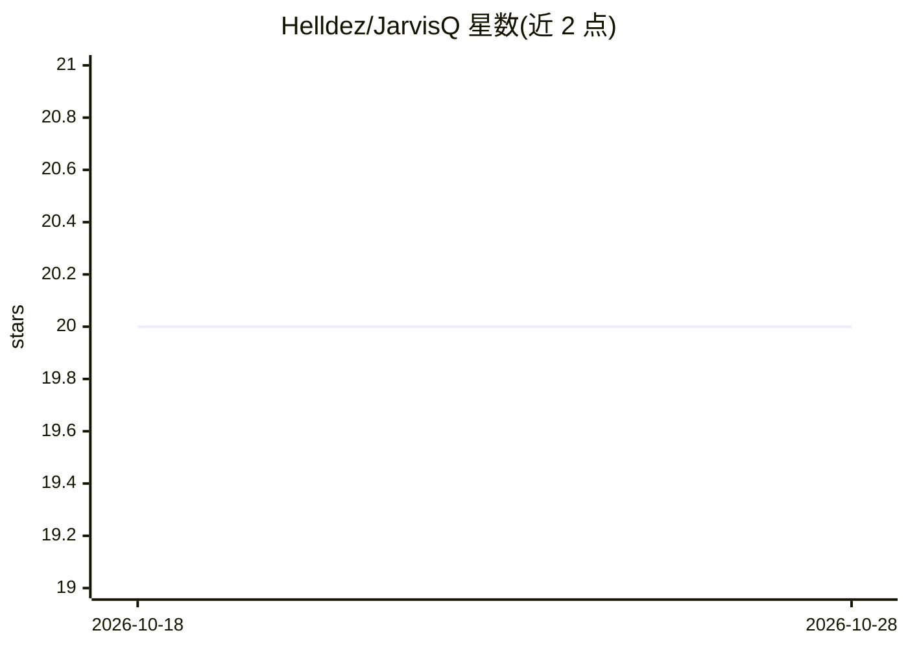

# Helldez/JarvisQ

⭐ 20 · TypeScript · Apache-2.0 · 推送 2026-05-07 · [GitHub](https://github.com/Helldez/JarvisQ) · [官网](https://github.com/Helldez/JarvisQ#readme) · 个人维护

**本地离线语音助手：STT→LLM→TTS 全在设备上运行**

面向终端用户的隐私优先语音助手，语音识别（Whisper/Parakeet）、对话（Qwen3 GGUF）与语音合成（Supertonic/系统 TTS）全部在设备本地运行，不做遥测，会话存于本地 SQLite。基于 Tether QVAC SDK 构建，采用六边形/端口-适配器架构，当前以 Expo/React Native 发布 Android 版，桌面版为 Electron 壳（Windows/macOS/Linux）。模型权重经 Hyperswarm P2P 或 HuggingFace HTTPS（锁定 commit SHA）首次分发；Android 需 ≥6 GB RAM 设备，需 Node.js ≥20 与 Expo 工具链从源码构建，未提供现成桌面安装包（Windows 构建命令存在但 desktop_builds 按 README 未声明发布产物，故记 false）。

## 筛选速览

| 维度 | 判定 | 备注 |
|---|---|---|
| AI 角色 | `ai-native` | 本体是模型或模型工具 |
| 许可风险 | `permissive` | Apache-2.0 |
| 部署形态 | `library` | 以包/库形式分发 |
| 模型依赖 | — | README 未给出锁定关系 |
| 硬件要求 | — | 无带数字的原话,不猜 |
| 安装摩擦 | `low` | 无编译、无系统依赖或容器化 |
| 成熟度 | — | 结构信号不足 |

## 能力要点

- STT/LLM/TTS 全流程设备内运行，无遥测，数据不上传
- 端口-适配器架构，同一核心支持 Android 与 Electron 桌面目标
- P2P（Hyperswarm）模型分发 + HuggingFace HTTPS 兜底，URL 锁定 commit SHA
- 流式/缓冲两种 TTS 时序模式与 Bergamot 离线翻译

## 适用场景

- 在手机上离线进行语音对话且不让数据离开设备
- 在无网络或强隐私要求环境下使用语音助手
- 在 Windows 桌面本地运行同一套语音助手核心

## 场景标签

`语音 Agent` · 领域:对话与助手

## 证据(README 行号)

> L8: Private, on-device voice assistant — STT → LLM → TTS pipeline running fully
> L24: - **Fully on-device**. Speech recognition, language modelling, and speech
> L48: - **Large language model** — Qwen3 1.7B / 4B (GGUF, llama.cpp).

## 星数曲线

2026-10-18 20 → 2026-10-28 20（+0）

---
*卡片 v1 · prompt 1.4 · 生成 2026-10-28 · 置信度 high · 依据 README sha `730ca62ef020` · [字段定义](../../DATASET.md)*
