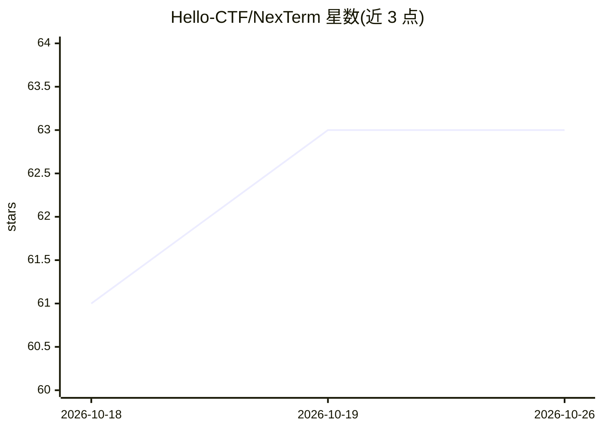

# Hello-CTF/NexTerm

⭐ 63 · Go · MIT · 推送 2026-10-25 · [GitHub](https://github.com/Hello-CTF/NexTerm) · [官网](https://nexterm.work) · 组织维护 · 中文 README

**自托管的多协议终端工作台，内置 AI 运维助手**

NexTerm 是可自托管的服务器运维工作台，通过 SSH、WinRM 或设备 agent 连接主机，集成持久终端、SFTP 文件管理、Docker 容器、MySQL/PostgreSQL/Redis 数据库、端口转发与终端分享。AI 助手提供 20+ 工具在用户确认后执行命令与修复操作，兼容任意 OpenAI 接口并内置 DeepSeek、Kimi、GLM、Ollama 预设。桌面端覆盖 Windows/macOS/Linux，服务端通过脚本安装，支持多用户与 TOTP 认证。移动端为预览版，非正式支持平台。

## 筛选速览

| 维度 | 判定 | 备注 |
|---|---|---|
| AI 角色 | `ai-enhanced` | 去掉 AI 部分产品仍成立 |
| 许可风险 | `permissive` | MIT |
| 部署形态 | `desktop` | 安装包/桌面程序 |
| 模型依赖 | — | README 未给出锁定关系 |
| 硬件要求 | — | 无带数字的原话,不猜 |
| 安装摩擦 | `low` | 无编译、无系统依赖或容器化 |
| 成熟度 | `idea` | |

## 能力要点

- 20+ 工具的 AI 助手，执行前展示命令或 diff，支持按主机和路径授权
- 持久终端在断网/重启后可从任意设备接管并补回输出
- SFTP、Docker、MySQL/PostgreSQL/Redis、SOCKS5 转发与设备 agent 管理
- 多用户、TOTP 双因素、端到端加密同步与审计日志的自托管服务端

## 适用场景

- 在一个窗口里管理多台服务器的终端、文件与数据库
- 让 AI 助手在确认后代为排查和执行运维命令
- 把终端会话分享给同事协作而不交出密码或私钥

## 场景标签

`AI 助手` · 领域:对话与助手

## 证据(README 行号)

> L22: NexTerm 把远程运维放进一个窗口：通过 SSH、WinRM 或设备 agent 连接主机，让 AI 助手在你确认后排查和修复问题，再处理文件、容器、数据库、设备监控和终端分享。图片使用示例数据，可在官网体验在线演示。
> L26: - **🤖 会动手的 AI**：20+ 工具覆盖命令、文件、Docker 和终端输出；执行前展示命令或 diff，支持计划模式、按主机和路径授权、定时任务和长期记忆；兼容任意 OpenAI 接口，内置 DeepSeek、Kimi、

## 星数曲线

2026-10-18 61 → 2026-10-26 63（+2）

---
*卡片 v1 · prompt 1.4 · 生成 2026-10-24 · 置信度 mid · 依据 README sha `96fe0cb5258d` · [字段定义](../../DATASET.md)*
