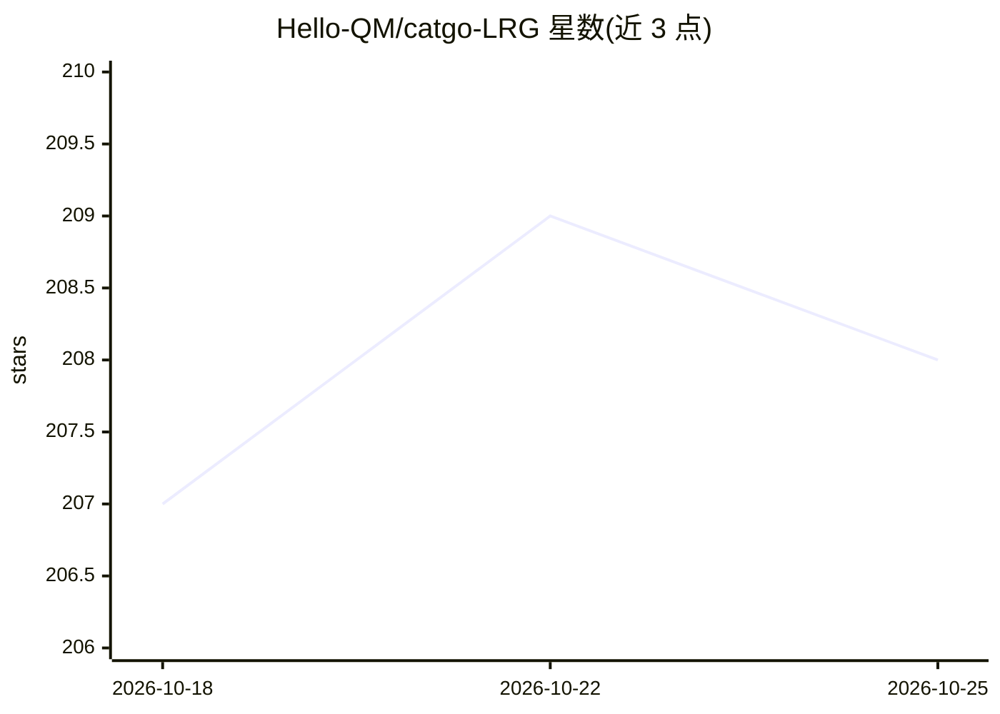

# Hello-QM/catgo-LRG

⭐ 208 · TypeScript · AGPL-3.0 · 推送 2026-10-22 · [GitHub](https://github.com/Hello-QM/catgo-LRG) · 组织维护 · 中文 README

**面向计算材料科学研究者的 AI 工作台：建模、工作流与 HPC 一体化**

Tauri+SvelteKit 前端、FastAPI 后端的科研工作台，整合 3D 结构编辑器、可视化 DAG 工作流引擎、SSH 远程集群访问、作业监控与结构/轨迹/电子结构/催化结果分析；CatBot 助手支持自然语言完成取结构、建模、工作流编辑等操作。驱动 VASP/ORCA/CP2K/QE 等计算代码生成输入，但许可代码与算力需用户自备。提供桌面、Web、VS Code、iOS/Android 多入口及 CLI/MCP 接口。

## 筛选速览

| 维度 | 判定 | 备注 |
|---|---|---|
| AI 角色 | `ai-enhanced` | 去掉 AI 部分产品仍成立 |
| 许可风险 | `viral` | AGPL-3.0 |
| 部署形态 | `desktop` | 安装包/桌面程序 |
| 模型依赖 | — | README 未给出锁定关系 |
| 硬件要求 | — | 无带数字的原话,不猜 |
| 安装摩擦 | `low` | 无编译、无系统依赖或容器化 |
| 成熟度 | `idea` | |

## 能力要点

- CatBot 自然语言助手（结构检索、建模、工作流编辑），工具调用过程可审查
- 可视化 DAG 工作流引擎串联几何优化、NEB、MD 等计算步骤
- SSH 连接 HPC 集群：提交调度器作业、跟踪日志与收敛、回收结果
- 多种入口：桌面/Web/VS Code/iOS/Android 及 catgo CLI 与 MCP 服务

## 适用场景

- 在统一工作台内完成从取结构、建模到提交 HPC 计算的日常流程
- 让 CatBot 用自然语言代为切 slab、加吸附物、生成计算输入
- 在手机上查看集群作业与远程结构/轨迹文件
- 通过 MCP 让 Claude Code 等外部 agent 驱动 CatGo 后端

## 场景标签

`工作流自动化` `代码生成` `科研工具` · 领域:效率与自动化

## 证据(README 行号)

> L23: CatGo brings the everyday tools of computational materials science into one workspace: an interactive 3D structure 
> L36: |**Work with CatBot**|Ask for structure retrieval, model construction, workflow editing, file inspection, or analys

## 星数曲线

2026-10-18 207 → 2026-10-25 208（+1）

---
*卡片 v1 · prompt 1.4 · 生成 2026-10-22 · 置信度 high · 依据 README sha `572aa8e27ac2` · [字段定义](../../DATASET.md)*
