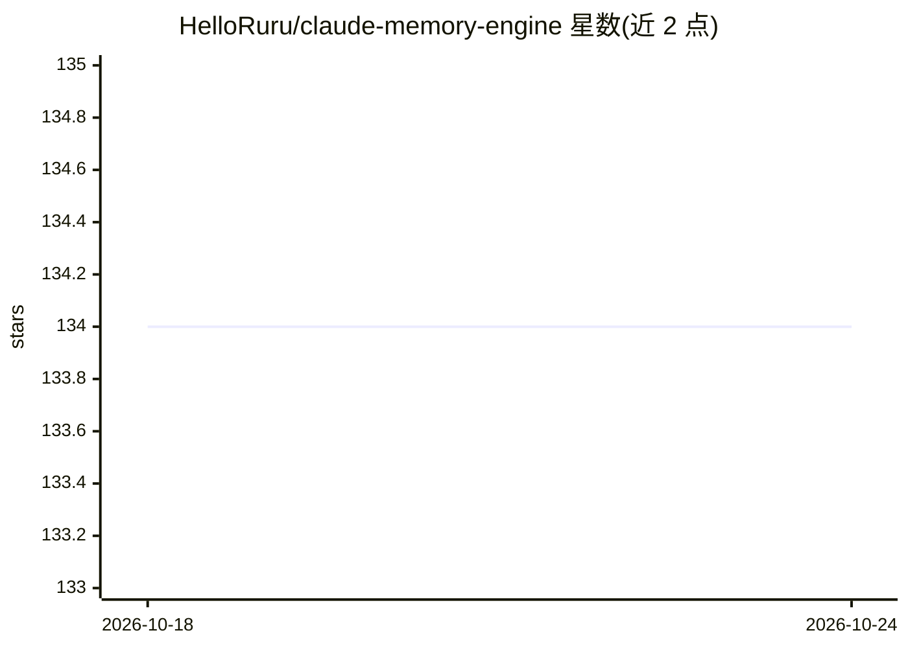

# HelloRuru/claude-memory-engine

⭐ 134 · JavaScript · MIT · 推送 2026-05-11 · [GitHub](https://github.com/HelloRuru/claude-memory-engine) · 个人维护 · 中文 README

**Claude Code 的长期记忆与学习系统（hooks + markdown，零依赖）**

面向 Claude Code 使用者的记忆引擎插件：以 8 个自动 hooks（session-start/pre-compact/每 20 条消息检查点等）配合 markdown 文件保存对话摘要、项目记忆与踩坑记录，无需数据库与外部 API。提供 Student Loop 八步学习循环（/reflect）、纠错循环（/analyze、/correct）、跨项目 Smart Context 按工作目录自动加载记忆，以及基于私有 GitHub 仓库的跨设备双向同步（v2.0 同步整个 ~/.claude/ 环境）。运行要求 Node 18+，命令均有英文与繁体中文版本。

## 筛选速览

| 维度 | 判定 | 备注 |
|---|---|---|
| AI 角色 | `ai-ecosystem` | LLM/agent 周边工具 |
| 许可风险 | `permissive` | MIT |
| 部署形态 | `None` |  |
| 模型依赖 | — | README 未给出锁定关系 |
| 硬件要求 | — | 无带数字的原话,不猜 |
| 安装摩擦 | `low` | 无编译、无系统依赖或容器化 |
| 成熟度 | — | 结构信号不足 |

## 能力要点

- 8 个自动 hooks 在会话开始/结束、压缩前、每 20 条消息时保存记忆
- Student Loop 反思循环与错误笔记本：同类错误 3 次以上升级为硬规则
- v2.0 全环境同步：CLAUDE.md、commands、hooks、skills 经私有 GitHub 仓库跨设备同步
- 所有数据为 markdown 与 JS 文件，无数据库、无外部 API、零依赖

## 适用场景

- 让 Claude Code 新会话保留我的偏好、项目规则与踩坑经验
- 多窗口/多会话之间交接工作进度（/handoff）
- 换电脑或重装系统后用 /recover 恢复全部记忆与配置

## 场景标签

`Agent 记忆` · 领域:Agent 开发

## 证据(README 行号)

> L13:  Claude Code Hooks
> L198:  8 Hooks (all automatic)
> L210: ## :arrows_counterclockwise: Cross-device Sync (rewritten in v2.0)

## 星数曲线

2026-10-18 134 → 2026-10-24 134（+0）

---
*卡片 v1 · prompt 1.4 · 生成 2026-10-22 · 置信度 high · 依据 README sha `5a8578ad812d` · [字段定义](../../DATASET.md)*
