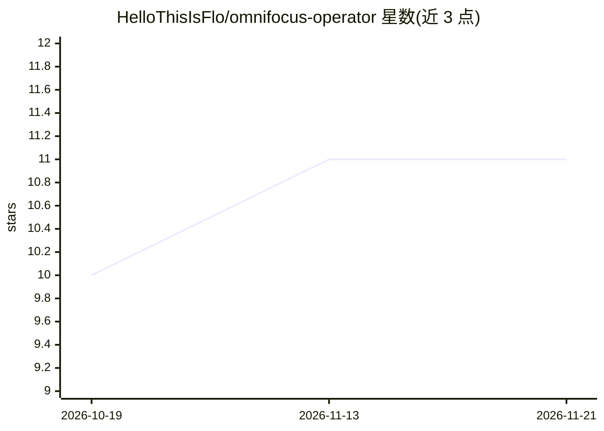

# HelloThisIsFlo/omnifocus-operator

⭐ 11 · Python · 推送 2026-11-13 · [GitHub](https://github.com/HelloThisIsFlo/omnifocus-operator) · 个人维护

**面向 AI agent 的 OmniFocus MCP 服务器：让 agent 读写任务**

通过 Model Context Protocol 将 OmniFocus 暴露为结构化任务数据的 MCP 服务器，供 AI agent 调用 11 个工具：任务/项目/标签/文件夹/视角的查询与过滤，以及任务的创建与补丁式编辑。采用 SQLite 缓存加速读取，必要时回退 OmniJS 桥接。仅支持 macOS + OmniFocus 4 + Python 3.12+，通过 uvx 运行，无需安装步骤。许可为专有，免费使用、禁止再分发。

## 筛选速览

| 维度 | 判定 | 备注 |
|---|---|---|
| AI 角色 | `ai-ecosystem` | LLM/agent 周边工具 |
| 许可风险 | `none` | — |
| 部署形态 | `library` | 以包/库形式分发 |
| 模型依赖 | — | README 未给出锁定关系 |
| 硬件要求 | — | 无带数字的原话,不猜 |
| 安装摩擦 | `low` | 无编译、无系统依赖或容器化 |
| 成熟度 | — | 结构信号不足 |

## 能力要点

- 11 个 MCP 工具覆盖任务/项目/标签/文件夹/视角的查询与写入
- SQLite 缓存读取，必要时自动回退 OmniJS 桥接
- 提供 Claude Desktop、Claude Code、OpenCode、Cursor 的配置接入方式
- 2,561 个测试，97% 覆盖率

## 适用场景

- 让 Claude 等 AI agent 读取并过滤 OmniFocus 任务列表
- 通过对话创建和批量编辑任务
- 为 agent 客户端接入结构化任务管理数据源

## 场景标签

`工作流自动化` · 领域:效率与自动化

## 证据(README 行号)

> L11: Production-grade MCP server exposing OmniFocus as structured task infrastructure for AI agents. Agent-first design,
> L74: - 🛠️ **11 MCP tools** — lookups, filtered lists, task creation & editing

## 星数曲线

2026-10-19 10 → 2026-11-21 11（+1）

---
*卡片 v1 · prompt 1.4 · 生成 2026-11-19 · 置信度 high · 依据 README sha `6cd710d40d3f` · [字段定义](../../DATASET.md)*
