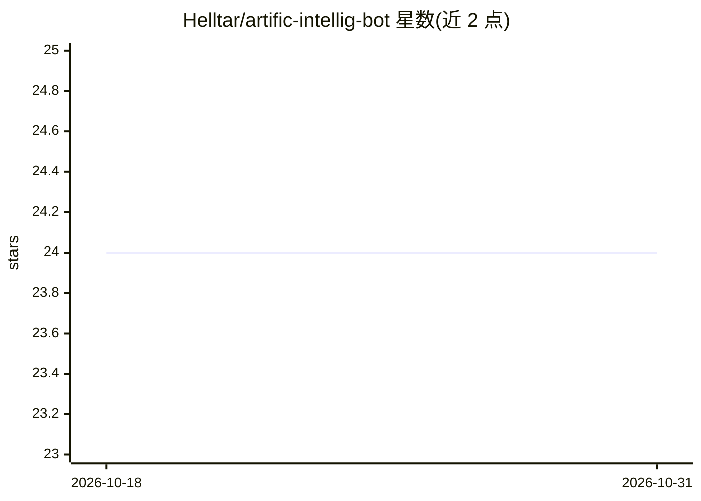

# Helltar/artific-intellig-bot

⭐ 24 · Kotlin · MIT · 推送 2026-10-24 · [GitHub](https://github.com/Helltar/artific-intellig-bot) · 个人维护

**群聊 Telegram 机器人：问答、图片描述与图像生成**

面向 Telegram 群聊的自托管机器人，通过 OpenAI API 提供问答、图片分析与文生图功能。以 Docker Compose 部署，内置 PostgreSQL 服务，通过 .env 配置 bot token、OpenAI key 与数据库连接。支持自定义人格提示词文件（挂载进容器）、管理员/所有者命令体系（封禁、聊天白名单、切换模型、设置推理强度与速率限制），并持久化用户对话历史，可查看或清除。

## 筛选速览

| 维度 | 判定 | 备注 |
|---|---|---|
| AI 角色 | `ai-native` | 本体是模型或模型工具 |
| 许可风险 | `permissive` | MIT |
| 部署形态 | `self-host` | docker 或自建部署 |
| 模型依赖 | — | README 未给出锁定关系 |
| 硬件要求 | — | 无带数字的原话,不猜 |
| 安装摩擦 | `low` | 无编译、无系统依赖或容器化 |
| 成熟度 | — | 结构信号不足 |

## 能力要点

- /chat 问答与图片分析，/imgen 文生图
- 通过挂载 personality.md 自定义机器人人格
- Docker Compose 一键部署，自带 PostgreSQL 服务
- 管理员/所有者命令：封禁、白名单、切换模型、速率限制

## 适用场景

- 在 Telegram 群里自托管一个 AI 问答与画图机器人
- 给机器人配置自定义人格以匹配群组氛围
- 管理员控制谁能使用、在哪些群使用及调用频率

## 场景标签

`聊天机器人` `图像生成` · 领域:对话与助手

## 证据(README 行号)

> L6: A Telegram bot for group chats that answers questions, describes images, and generates new ones with the OpenAI API.
> L85: - `/chat` — chat with the bot; reply to a photo to analyze it
> L86: - `/imgen` — generate an image from a text prompt

## 星数曲线

2026-10-18 24 → 2026-10-31 24（+0）

---
*卡片 v1 · prompt 1.4 · 生成 2026-10-27 · 置信度 high · 依据 README sha `449835af7e2e` · [字段定义](../../DATASET.md)*
