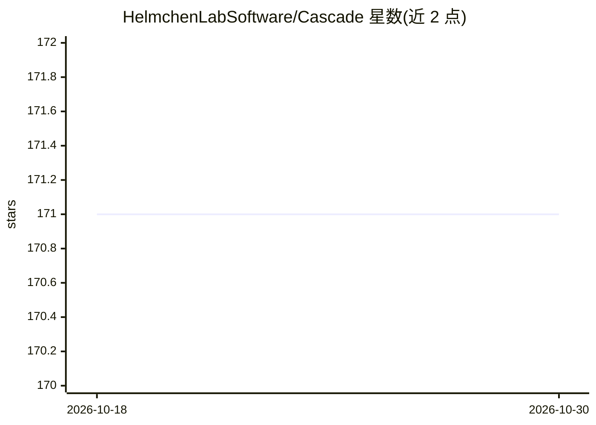

# HelmchenLabSoftware/Cascade

⭐ 171 · Jupyter Notebook · GPL-3.0 · 推送 2026-10-27 · [GitHub](https://github.com/HelmchenLabSoftware/Cascade) · 组织维护

**从钙成像数据推断神经元放电的深度学习工具箱**

Cascade 将钙成像 ΔF/F 信号转换为放电概率或离散脉冲：内置覆盖脑区、钙指示剂与物种的真值数据库，提供按噪声水平与帧率重采样训练数据的流程、多种预训练深度网络，以及将推断放电率转换为离散脉冲的工具。提供 Colab Notebook 免安装使用，或经 conda 本地安装；虽基于深度网络但 GPU 非必需，可集成到 CaImAn/Suite2P 流程。主要面向神经科学研究者。

## 筛选速览

| 维度 | 判定 | 备注 |
|---|---|---|
| AI 角色 | `ai-native` | 本体是模型或模型工具 |
| 许可风险 | `viral` | GPL-3.0 |
| 部署形态 | `library` | 以包/库形式分发 |
| 模型依赖 | — | README 未给出锁定关系 |
| 硬件要求 | `cpu-ok` | |
| 安装摩擦 | `low` | 无编译、无系统依赖或容器化 |
| 成熟度 | — | 结构信号不足 |

## 能力要点

- 深度网络从钙数据预测放电率，输出放电概率或离散脉冲
- 覆盖多脑区、多钙指示剂与物种的持续更新真值数据库（35 个数据集、400+ 神经元）
- 大量不同条件下的预训练网络，含 GCaMP8 与脊髓数据模型
- GPU 非必需，训练可在 CPU 上运行

## 适用场景

- 将双光子钙成像记录转换为神经元放电率
- 比较不同指示剂（如 GCaMP8）下的单脉冲检测
- 将放电推断集成到 CaImAn/Suite2P 既有分析流程

## 场景标签

 · 领域:神经科学/钙成像分析

## 证据(README 行号)

> L8: *Cascade* translates calcium imaging ΔF/F traces into spiking probabilities or discrete spikes.
> L15: - A deep network that is trained to predict spike rates from calcium data
> L99: If you want to modify the code, if you want to integrate the algorithm into your existing pipeline (e.g., with CaIm

## 星数曲线

2026-10-18 171 → 2026-10-30 171（+0）

---
*卡片 v1 · prompt 1.4 · 生成 2026-10-22 · 置信度 mid · 依据 README sha `6a38e39d5a57` · [字段定义](../../DATASET.md)*
