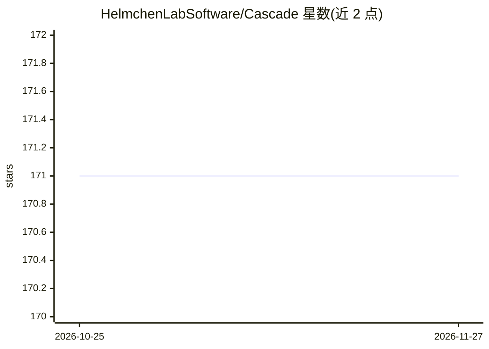

# HelmchenLabSoftware/Cascade

⭐ 171 · Jupyter Notebook · GPL-3.0 · 推送 2026-11-01 · [GitHub](https://github.com/HelmchenLabSoftware/Cascade) · 组织维护

**用深度网络从钙成像ΔF/F轨迹推断放电的科研工具**

Cascade 将双光子钙成像的 ΔF/F 轨迹转换为放电概率或离散 spike。工具箱包含持续更新的 ground truth 数据库（35 个数据集、>400 神经元，覆盖多种钙指示剂、脑区与物种）、训练好的预训练模型库、按噪声水平与帧率重采样训练数据的流程，以及量化分布外泛化和将放电率转为离散 spike 的工具。可通过 Colab Notebook 免安装使用，也可在 Ubuntu/Windows 本地用 Anaconda 安装；GPU 非必需。科研用户需注意早期版本依赖 Tensorflow 2.1 的安装已弃用。

## 筛选速览

| 维度 | 判定 | 备注 |
|---|---|---|
| AI 角色 | `ai-native` | 本体是模型或模型工具 |
| 许可风险 | `viral` | GPL-3.0 |
| 部署形态 | `library` | 以包/库形式分发 |
| 模型依赖 | — | README 未给出锁定关系 |
| 硬件要求 | `cpu-ok` | |
| 安装摩擦 | `low` | 无编译、无系统依赖或容器化 |
| 成熟度 | — | 结构信号不足 |

## 能力要点

- 预训练模型库覆盖多种钙指示剂（GCaMP6/7/8、R-CaMP、jRGECO 等）与脑区、物种
- ground truth 数据库含 35 个数据集、>400 神经元，可在线浏览
- 提供 Colab Notebook 免安装云端运行路径
- GPU 非必需，CPU 即可运行推理与训练

## 适用场景

- 将双光子钙成像记录转换为绝对放电率估计
- 把 spike 推断接入 CaImAn 或 Suite2P 的既有流程
- 训练自定义网络适配特定噪声水平与帧率的记录

## 场景标签

`科研工具` · 领域:学习与行业

## 证据(README 行号)

> L8: *Cascade* translates calcium imaging ΔF/F traces into spiking probabilities or discrete spikes.
> L15: - A deep network that is trained to predict spike rates from calcium data
> L101: If you want to modify the code, if you want to integrate the algorithm into your existing pipeline (e.g., with CaI

## 星数曲线

2026-10-25 171 → 2026-11-27 171（+0）

---
*卡片 v1 · prompt 1.4 · 生成 2026-11-26 · 置信度 mid · 依据 README sha `4b259494b823` · [字段定义](../../DATASET.md)*
