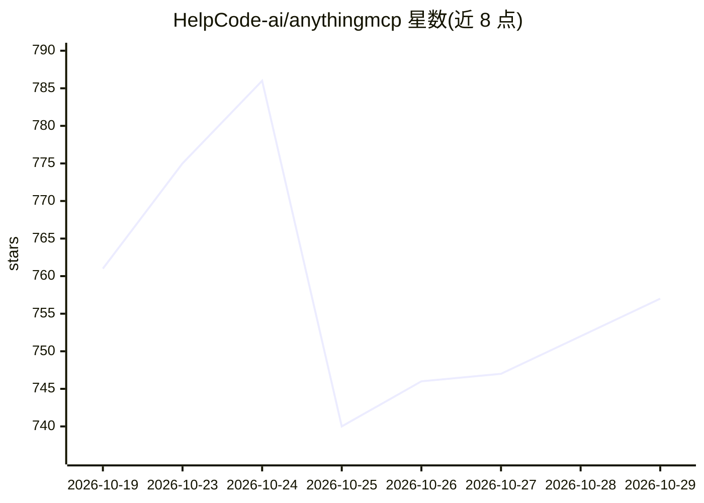

# HelpCode-ai/anythingmcp

⭐ 757 · TypeScript · AGPL-3.0 · 推送 2026-10-28 · [GitHub](https://github.com/HelpCode-ai/anythingmcp) · [官网](https://anythingmcp.com) · 组织维护 · 中文 README

**自托管 MCP 网关：把 REST/SOAP/GraphQL/SQL 系统变成 MCP 工具**

面向需要让 Claude、ChatGPT、Copilot 等 MCP 客户端调用企业系统的团队：AnythingMCP 将 REST/OpenAPI、SOAP/WSDL、GraphQL、OData、SQL/MongoDB 数据源转为 MCP 工具，提供 529 个预置连接器（覆盖 SAP、Odoo、Amazon Seller、Etsy 等，其中 24 个无需 API key），并含 RBAC、SSO/SCIM、审计日志、响应字段映射与凭证 AES-256-GCM 加密。通过 Docker Compose 自托管运行，也有托管云版本；镜像目前仅 amd64，Apple Silicon 需模拟运行。AGPL-3.0 许可。

## 筛选速览

| 维度 | 判定 | 备注 |
|---|---|---|
| AI 角色 | `ai-ecosystem` | LLM/agent 周边工具 |
| 许可风险 | `dual` | AGPL-3.0 |
| 部署形态 | `self-host` | docker 或自建部署 |
| 模型依赖 | locked-api |  |
| 硬件要求 | — | 无带数字的原话,不猜 |
| 安装摩擦 | `low` | 无编译、无系统依赖或容器化 |
| 成熟度 | — | 结构信号不足 |

## 能力要点

- 529 个预置连接器、2,400+ 工具，24 个无需 API key
- 支持 OpenAPI/SOAP/GraphQL/OData/SQL/Postman 等 API 转 MCP 工具
- RBAC、SSO/SCIM、审计日志与响应字段级映射（含脱敏裁剪）
- 工具运行时注册，无需重启；数据库工具默认只读

## 适用场景

- 让 Claude/ChatGPT 直接查询 SAP、ERP 和电商系统数据
- 把企业遗留 SOAP 服务或数据库暴露为 MCP 工具
- 通过字段映射控制哪些数据可以发送给模型

## 场景标签

 · 领域:AI 基础设施/MCP 网关

## 证据(README 行号)

> L13:  AnythingMCP is an open-source, self-hosted MCP gateway that turns any REST/OpenAPI, SOAP, GraphQL, OData or SQL sy
> L58: 1. **Add a connector.** Install an **adapter** from the catalog (a ready JSON definition for SAP, Odoo, DHL and the
> L60: 3. **Hand one URL to your AI client.** An **MCP server** is the endpoint you add to Claude, ChatGPT, Copilot, Gemin

## 星数曲线

2026-10-19 761 → 2026-10-29 757（-4）

---
*卡片 v1 · prompt 1.4 · 生成 2026-10-22 · 置信度 high · 依据 README sha `58b5fa2a9e1c` · [字段定义](../../DATASET.md)*
