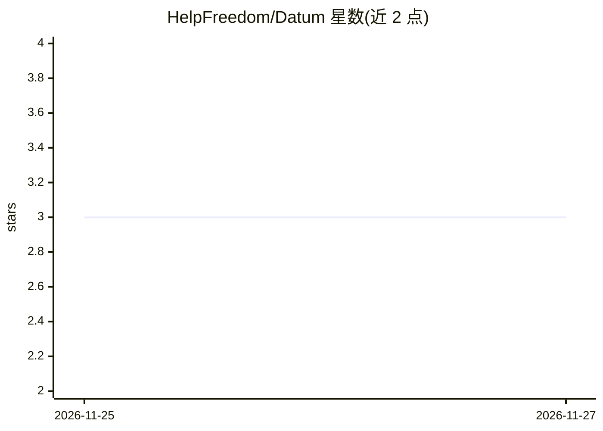

# HelpFreedom/Datum

⭐ 3 · Python · MIT · 推送 2026-11-23 · [GitHub](https://github.com/HelpFreedom/Datum) · 个人维护

**AI 驱动的工程 CAD 编辑器：agent 设计与计算，人类引导**

面向机械/3D 打印工程的 AI-first 编辑器：用户用自然语言下达任务，内置 agent 用 Python 脚本建模（manifold3d 内核）、跟踪每个参数的来源（measured/assumed/derived/standard）、运行装配与强度检查（P2 四面体 FEM）、MuJoCo 机构仿真与 3D 打印可行性检查，失败时自行修正。每个 Datum 操作同时是 MCP 工具；窗口基于 Electron + three.js，与 agent 共享视图。针对 Claude Code 构建窗口、技能与评审机制，其他 MCP 兼容 agent 可通过 `datum mcp --stdio` 接入但功能不完整；无 agent 时仅为库与命令集。仅在 Linux x86-64 上验证过。

## 筛选速览

| 维度 | 判定 | 备注 |
|---|---|---|
| AI 角色 | `ai-native` | 本体是模型或模型工具 |
| 许可风险 | `permissive` | MIT |
| 部署形态 | `None` |  |
| 模型依赖 | locked-api |  |
| 硬件要求 | — | 无带数字的原话,不猜 |
| 安装摩擦 | `low` | 无编译、无系统依赖或容器化 |
| 成熟度 | `idea` | |

## 能力要点

- 所有操作以 MCP 工具暴露，可被任意 MCP 兼容 agent 调用
- 参数来源追踪（measured/assumed/derived/standard）与测量优先级展开
- FEM 强度分析输出区间而非单值，MuJoCo 机构仿真与 GLB/MJCF/URDF 导出
- AI-critic 多 agent 独立审查（/datum:audit）

## 适用场景

- 用对话方式为电路板或扫描件生成带卡扣的外壳与支撑座
- 验证舵机机械臂的扭矩、干涉与打印可行性后导出 3MF/STL
- 为 3D 打印零件做强度校核并获取需实测的关键尺寸

## 场景标签

`编码 Agent` · 领域:编码与开发

## 证据(README 行号)

> L5: **Инженерный ИИ-редактор: конструирует и считает ИИ-агент, человек ставит
> L12: Datum создан для агента. Его операции — это инструменты агента; проверки
> L17: агента Datum — это библиотека и набор команд, а не редактор.

## 星数曲线

2026-11-25 3 → 2026-11-27 3（+0）

---
*卡片 v1 · prompt 1.4 · 生成 2026-11-24 · 置信度 high · 依据 README sha `2c8b7f585388` · [字段定义](../../DATASET.md)*
