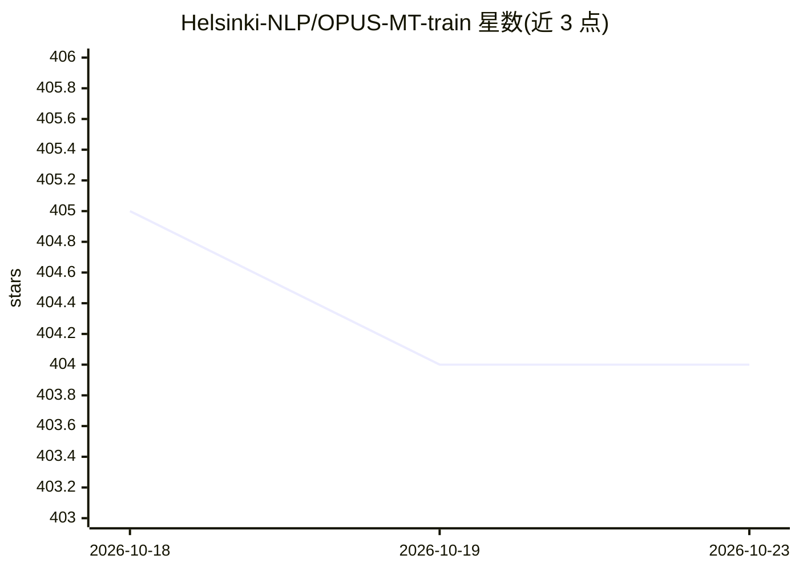

# Helsinki-NLP/OPUS-MT-train

⭐ 404 · Makefile · MIT · 推送 2026-01-17 · [GitHub](https://github.com/Helsinki-NLP/OPUS-MT-train) · 组织维护

**训练开源神经机器翻译模型的脚本与流水线（MarianNMT）**

Helsinki-NLP 维护的 OPUS-MT 训练包：基于 MarianNMT 与 OPUS 平行语料，通过 Makefile 目标完成多语言 NMT 模型的训练、评测与发布，支持回译、微调与枢轴语言翻译。同时提供可下载的预训练模型（CC-BY 4.0）。README 自述文档尚需完善，且当前仅在芬兰 CSC HPC 集群上运行良好，本地环境需自行调整 lib/env.mk 配置。

## 筛选速览

| 维度 | 判定 | 备注 |
|---|---|---|
| AI 角色 | `ai-ecosystem` | LLM/agent 周边工具 |
| 许可风险 | `permissive` | MIT |
| 部署形态 | `None` |  |
| 模型依赖 | — | README 未给出锁定关系 |
| 硬件要求 | — | 无带数字的原话,不猜 |
| 安装摩擦 | `medium` | 含编译或系统依赖之一 |
| 成熟度 | `idea` | |

## 能力要点

- Makefile 驱动的 train/eval/release 训练流水线
- 支持多语言模型训练、回译、微调与枢轴语言翻译
- 提供 CC-BY 4.0 许可的预训练模型下载

## 适用场景

- 用 OPUS 平行语料训练 MarianNMT 翻译模型
- 参与 Tatoeba MT Challenge 训练低资源语言模型
- 获取多语言预训练翻译模型用于下游任务

## 场景标签

`模型训练` · 领域:训练与推理

## 证据(README 行号)

> L3: This package includes scripts for training NMT models using MarianNMT and OPUS data for OPUS-MT. More details are gi
> L25: make SRCLANGS="fi et" TRGLANGS="da sv en" train

## 星数曲线

2026-10-18 405 → 2026-10-23 404（-1）

---
*卡片 v1 · prompt 1.4 · 生成 2026-10-21 · 置信度 high · 依据 README sha `3ff246b39d6d` · [字段定义](../../DATASET.md)*
