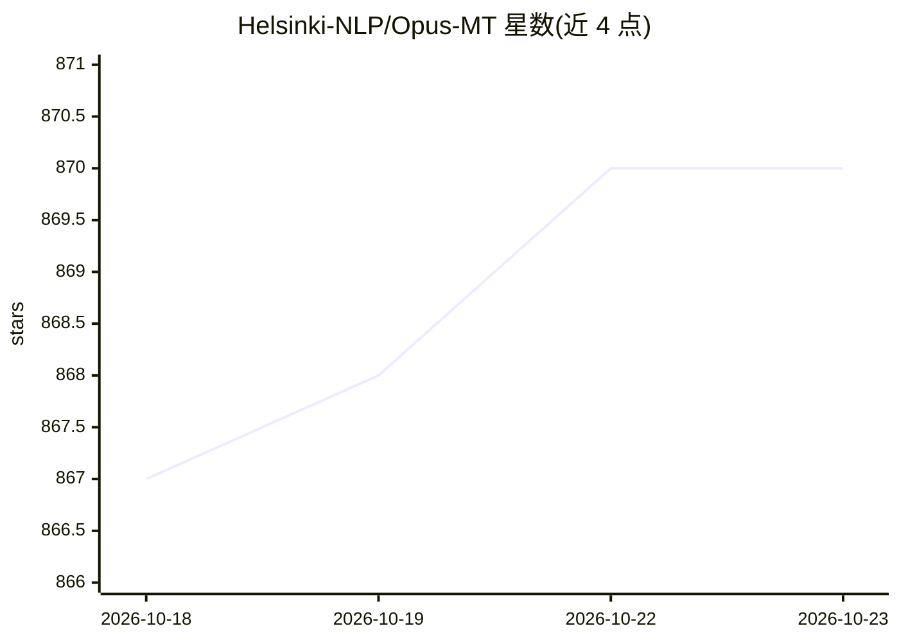

# Helsinki-NLP/Opus-MT

⭐ 870 · Python · MIT · 推送 2026-02-23 · [GitHub](https://github.com/Helsinki-NLP/Opus-MT) · 组织维护

**开源神经机器翻译模型与 Web 翻译服务工具集**

由赫尔辛基大学 Helsinki-NLP 团队维护的开源机器翻译项目：提供基于 Marian-NMT 训练、OPUS 数据训练的可下载翻译模型（CC-BY 4.0），并包含两套服务部署方式——Tornado Web 应用（提供网页界面与 API，支持多语言对）和 websocket 服务。通过 marian-server 子进程运行翻译，模型通过 services.json 配置。README 列出已知限制：模型多数未做数据过滤与领域适配、部分未在 72 小时训练限时内收敛、Tatoeba 自动评测偏乐观。训练脚本目前仅适配赫尔辛基大学与 CSC 环境。

## 筛选速览

| 维度 | 判定 | 备注 |
|---|---|---|
| AI 角色 | `ai-native` | 本体是模型或模型工具 |
| 许可风险 | `permissive` | MIT |
| 部署形态 | `self-host` | docker 或自建部署 |
| 模型依赖 | — | README 未给出锁定关系 |
| 硬件要求 | — | 无带数字的原话,不猜 |
| 安装摩擦 | `low` | 无编译、无系统依赖或容器化 |
| 成熟度 | — | 结构信号不足 |

## 能力要点

- 提供 Tornado Web 应用，含网页界面与 API，支持多语言对
- 基于 Marian-NMT 的预训练翻译模型，CC-BY 4.0 许可
- 支持 Docker 与 CUDA GPU Docker 部署
- 提供 websocket 服务安装方式

## 适用场景

- 自建多语言对机器翻译 Web 服务与 API
- 获取 CC-BY 许可的可下载 NMT 翻译模型
- 在 GPU 或 CPU 服务器上通过 Docker 部署翻译服务

## 场景标签

 · 领域:自然语言处理/机器翻译

## 证据(README 行号)

> L14: * Setup 1: a Tornado-based web application providing a web UI and API to work with multiple language pairs (develop
> L33: git clone https://github.com/Helsinki-NLP/Opus-MT.git

## 星数曲线

2026-10-18 867 → 2026-10-23 870（+3）

---
*卡片 v1 · prompt 1.4 · 生成 2026-10-21 · 置信度 high · 依据 README sha `8f85f6125583` · [字段定义](../../DATASET.md)*
