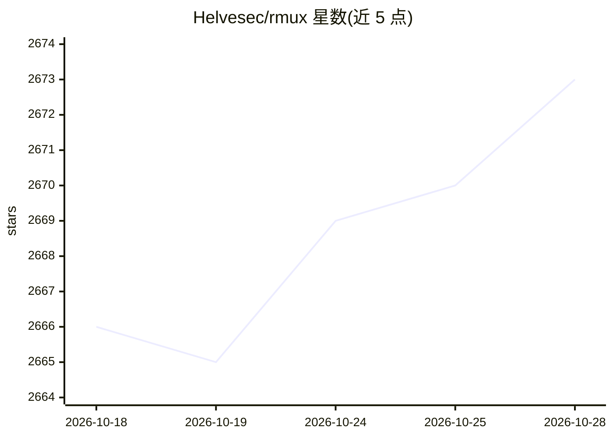

# Helvesec/rmux

⭐ 2,676 · Rust · NOASSERTION · 推送 2026-10-24 · [GitHub](https://github.com/Helvesec/rmux) · [官网](https://rmux.io) · 组织维护 · 中文 README

**Rust 终端多路复用引擎：兼容 tmux 命令并提供类型化 SDK**

用 Rust 编写的异步、类型化终端多路复用引擎，在 Linux、macOS、Windows 原生运行（无需 WSL），实现 90+ 条 tmux 兼容命令并有针对性兼容测试。可作为独立 CLI 使用、嵌入 Rust 终端应用，或通过 Rust/Python/TypeScript SDK 驱动任意 CLI/TUI 程序；本地守护进程架构会话与滚动缓冲保留在本机，另提供端到端加密的浏览器 Web Share 与 Claude Code teammate 模式。MIT/Apache-2.0 双许可。

## 筛选速览

| 维度 | 判定 | 备注 |
|---|---|---|
| AI 角色 | `ai-ecosystem` | LLM/agent 周边工具 |
| 许可风险 | `none` | NOASSERTION |
| 部署形态 | `desktop` | 安装包/桌面程序 |
| 模型依赖 | locked-api |  |
| 硬件要求 | — | 无带数字的原话,不猜 |
| 安装摩擦 | `low` | 无编译、无系统依赖或容器化 |
| 成熟度 | — | 结构信号不足 |

## 能力要点

- 实现 90+ 条 tmux 兼容命令，Windows 原生运行无需 WSL
- Rust/Python/TypeScript 类型化 SDK 连接本地守护进程做自动化
- Web Share：端到端加密的浏览器会话共享
- Claude Code teammate 模式与可安装的 Claude 技能

## 适用场景

- 在 Windows/macOS/Linux 上替代 tmux 管理终端会话
- 用 SDK 以代码驱动任意 CLI/TUI 程序做自动化
- 通过浏览器安全共享某个终端会话
- 在本地工作区以 tmux teammate 模式运行 Claude Code

## 场景标签

 · 领域:终端/开发工具

## 证据(README 行号)

> L41: Use it as a standalone CLI, embed it in Rust terminal apps, or drive it through typed SDKs for Rust, Python, and Ty
> L104: ## 🤝 Claude Teammate Mode

## 星数曲线

2026-10-18 2,666 → 2026-10-28 2,673（+7）

---
*卡片 v1 · prompt 1.4 · 生成 2026-10-21 · 置信度 low · 依据 README sha `68744c04908f` · [字段定义](../../DATASET.md)*
