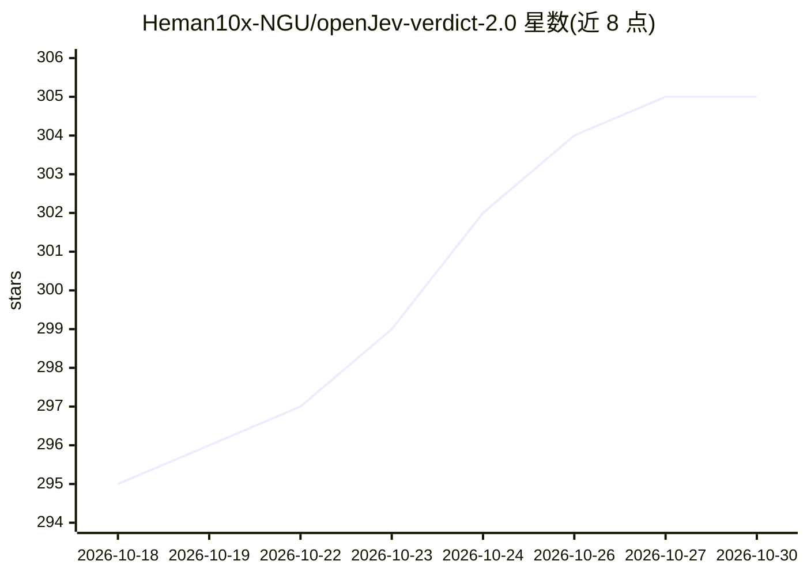

# Heman10x-NGU/openJev-verdict-2.0

⭐ 305 · Python · NOASSERTION · 推送 2026-10-21 · [GitHub](https://github.com/Heman10x-NGU/openJev-verdict-2.0) · [官网](https://heman10x-ngu.github.io/openJev-verdict-2.0/) · 个人维护

**149.6M 非自回归类型化决策模型：给确定性代码提供分类判定**

基于 ModernBERT-base 与 GLiClass 的非自回归决策模型，评估类型化决策模式（Choice/Score/Noul），单次前向推理约 20-25ms 并输出校准置信度，供确定性软件保留业务规则控制权。含两个模型：Verdict（151M，JevBench 评测，权重在 Hugging Face）与 Verdict 2.0（类型化工作流专用，权重经 Git LFS 跟踪）。支持双通道校准、选择性分类门控、置换 KL 对称训练降低选项翻转率，并可在浏览器内经 WebGPU 运行。提供 Python 用法示例与本地 WebGPU 演示目录。

## 筛选速览

| 维度 | 判定 | 备注 |
|---|---|---|
| AI 角色 | `ai-native` | 本体是模型或模型工具 |
| 许可风险 | `permissive` | NOASSERTION |
| 部署形态 | `None` |  |
| 模型依赖 | — | README 未给出锁定关系 |
| 硬件要求 | — | 无带数字的原话,不猜 |
| 安装摩擦 | `low` | 无编译、无系统依赖或容器化 |
| 成熟度 | — | 结构信号不足 |

## 能力要点

- 非自回归前向推理（约 20-25ms/决策）输出类型化决策与校准置信度
- 双通道校准：分布头（Brier 0.0636）与置信头（ECE 0.0144）分离
- 选择性分类：30% 覆盖率下准确率达 95.17%，支持人工升级门控
- 149.6M 参数模型可经 WebGPU 在浏览器内运行（<600 MB）

## 适用场景

- 企业决策工作流中替代 LLM 字符串解析，获得结构化类型决策输出
- 按置信度阈值自动放行高置信决策、路由低置信案例给人工
- 在浏览器内本地处理敏感数据（金融/PII）的决策任务

## 场景标签

 · 领域:机器学习/决策系统

## 证据(README 行号)

> L56: openJev-verdict-2.0 evaluates typed decision schemas (`Choice`, `Score`, `Noul`) in non-autoregressive forward pass
> L15: 1. Verdict (the 151M model evaluated on JevBench): General-purpose decision model based on ModernBERT-base and GLiC

## 星数曲线

2026-10-18 295 → 2026-10-30 305（+10）

---
*卡片 v1 · prompt 1.4 · 生成 2026-10-21 · 置信度 high · 依据 README sha `37f0f90400ba` · [字段定义](../../DATASET.md)*
