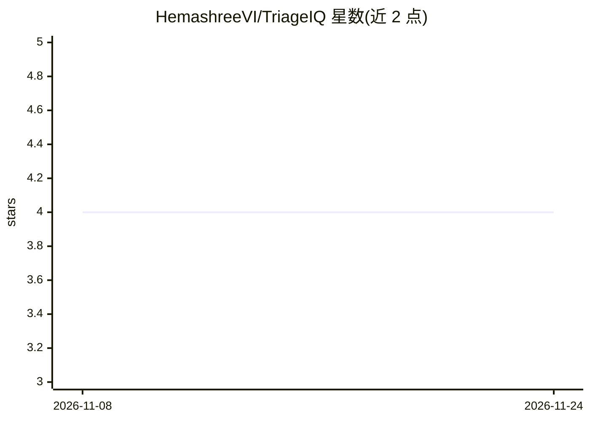

# HemashreeVI/TriageIQ

⭐ 4 · HTML · 推送 2026-11-17 · [GitHub](https://github.com/HemashreeVI/TriageIQ) · 个人维护

**面向客服团队的 LLM 工单分类与回复草拟系统**

事件驱动的客服邮件分诊流水线：IMAP 收件进入 Kafka 队列，本地 Ollama 运行的 Qwen 2.5 3B 按 JSON schema 输出类别/优先级/情绪，Qdrant 向量检索已解决工单（余弦相似度阈值 0.55）生成回复草稿，人工在控制台审批后才经 SMTP 发出。含 Message-ID 去重、自动回复跳过、发送者限频与会话登录等收件箱防护；模型不可用时回退为转人工。README 自述知识库为合成数据、准确率未实测。

## 筛选速览

| 维度 | 判定 | 备注 |
|---|---|---|
| AI 角色 | `ai-native` | 本体是模型或模型工具 |
| 许可风险 | `none` | — |
| 部署形态 | `None` |  |
| 模型依赖 | local-ok | 支持本地模型 |
| 硬件要求 | — | 无带数字的原话,不猜 |
| 安装摩擦 | `low` | 无编译、无系统依赖或容器化 |
| 成熟度 | — | 结构信号不足 |

## 能力要点

- 本地运行 Qwen 2.5 3B，客户文本不出机器，温度 0 保证确定性输出
- Ollama 不可用或输出越界时回退 needs_human 并置 High 优先级
- RAG 检索已解决工单生成有据可查的草稿，控制台显示引用来源
- 人工审批环节：批准/编辑/自写/转人工，仅批准后发送

## 适用场景

- 对支持邮箱的来信自动分类优先级并预拟回复
- 客服团队在审批队列中逐条处理 AI 草稿
- 本地化部署避免客户邮件内容外传

## 场景标签

`RAG` · 领域:知识与检索

## 证据(README 行号)

> L9: Receive → Queue → Classify → Retrieve → Draft → Approve
> L53: - The model is **Qwen 2.5 3B** (`qwen2.5:3b`) running locally in **Ollama**. Customer text never leaves the machine
> L74: - 30 past tickets and how they were solved are embedded with `nomic-embed-text` and stored in Qdrant (`rag/ingest.p

## 星数曲线

2026-11-08 4 → 2026-11-24 4（+0）

---
*卡片 v1 · prompt 1.4 · 生成 2026-11-21 · 置信度 high · 依据 README sha `dd4ff956f753` · [字段定义](../../DATASET.md)*
