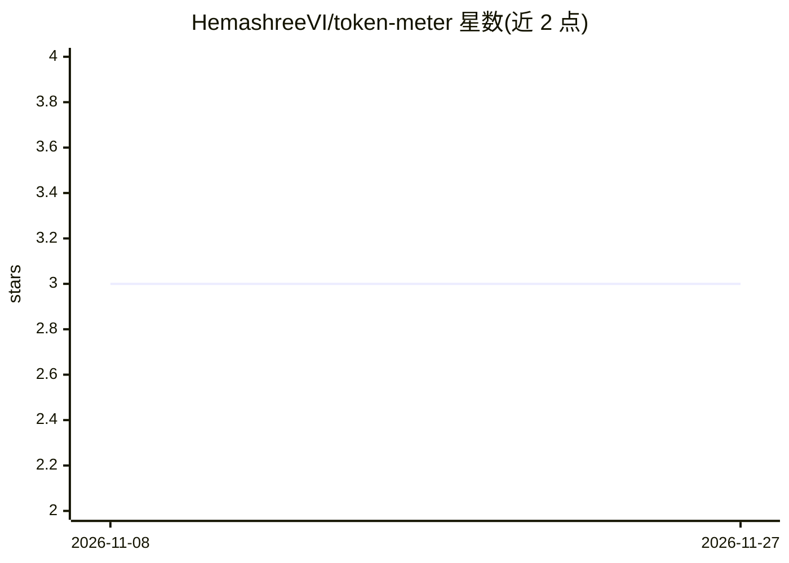

# HemashreeVI/token-meter

⭐ 3 · HTML · MIT · 推送 2026-11-25 · [GitHub](https://github.com/HemashreeVI/token-meter) · [官网](https://hemashreevi.github.io/token-meter/) · 个人维护

**浏览器端 token 计数工具：查看消息用量与上下文余量**

单页浏览器工具，粘贴提示词与 AI 回复后显示：每条消息 token 数（实时计数）、上下文窗口占用分解（应用开销/用户消息/AI 回复）、剩余轮次与自定义用量预算，以及图片按像素大小的成本估算。ChatGPT/GPT-4o 使用 OpenAI o200k_base tokenizer 给出精确计数，Claude 与 Gemini 则按该 tokenizer 缩放估算。数据保存在浏览器 localStorage，无安装与构建步骤。

## 筛选速览

| 维度 | 判定 | 备注 |
|---|---|---|
| AI 角色 | `ai-ecosystem` | LLM/agent 周边工具 |
| 许可风险 | `permissive` | MIT |
| 部署形态 | `None` |  |
| 模型依赖 | — | README 未给出锁定关系 |
| 硬件要求 | — | 无带数字的原话,不猜 |
| 安装摩擦 | `low` | 无编译、无系统依赖或容器化 |
| 成熟度 | — | 结构信号不足 |

## 能力要点

- 浏览器内实时 token 计数与上下文占用分解
- GPT-4o 精确计数（o200k_base tokenizer），Claude/Gemini 缩放估算
- 图片按像素大小估算 token 成本
- 数据仅存于 localStorage，不外发

## 适用场景

- 编写 prompt 时实时查看 token 消耗与预算剩余
- 了解多轮对话中每轮重发整段聊天带来的递增成本
- 估算上下文窗口占用，避免超出模型容量

## 场景标签

`提示工程` · 领域:Agent 开发

## 证据(README 行号)

> L3: A single-page tool that shows how many tokens your AI chat uses while you chat.
> L17: Open `index.html` in any browser, or visit the GitHub Pages site for this repo. No install or build step needed.

## 星数曲线

2026-11-08 3 → 2026-11-27 3（+0）

---
*卡片 v1 · prompt 1.4 · 生成 2026-11-22 · 置信度 high · 依据 README sha `68aee3504288` · [字段定义](../../DATASET.md)*
