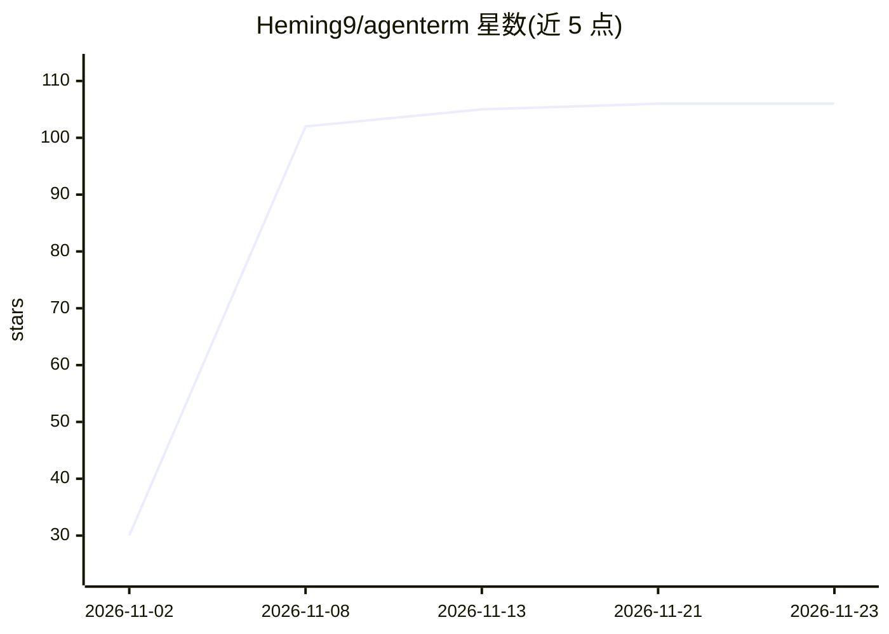

# Heming9/agenterm

⭐ 106 · Go · Apache-2.0 · 推送 2026-11-20 · [GitHub](https://github.com/Heming9/agenterm) · 个人维护 · 中文 README

**让 AI agent 通过 MCP 远程协助控制他人电脑的自托管工具**

自托管的 AI agent 远程协助系统：agent 经 MCP（Streamable HTTP）连接服务器，被控端运行客户端并授权后，agent 即可经 WebSocket 中继在该终端上执行任务，无需 SSH 或开放入站端口。支持 macOS/Linux/Windows、CLI 与 GUI 客户端，可使用托管服务或自部署服务器。提供终端访问而非远程桌面，被控方可随时查看输出并断开。限制：托管服务管理端当前无需认证，按邀请创建者 IP 限制在线设备数。

## 筛选速览

| 维度 | 判定 | 备注 |
|---|---|---|
| AI 角色 | `ai-ecosystem` | LLM/agent 周边工具 |
| 许可风险 | `permissive` | Apache-2.0 |
| 部署形态 | `None` |  |
| 模型依赖 | — | README 未给出锁定关系 |
| 硬件要求 | — | 无带数字的原话,不猜 |
| 安装摩擦 | `low` | 无编译、无系统依赖或容器化 |
| 成熟度 | — | 结构信号不足 |

## 能力要点

- 经 MCP Streamable HTTP 接入 agent，一条授权命令建立连接
- 无需 SSH 或入站端口，被控端可实时查看并随时断开
- 支持 macOS/Linux/Windows，提供 CLI 与 GUI 客户端
- 可自托管服务器，客户端断线后自动重连

## 适用场景

- 让 AI agent 远程排查同事或客户的电脑问题
- 用熟悉的 agent 操作另一台开发机或服务器
- 连接多台测试机并汇总检查结果

## 场景标签

`GUI 自动化` · 领域:效率与自动化

## 证据(README 行号)

> L7:  Supports MCP Streamable HTTP
> L24:  Connection workflow: connect Agent to MCP, ask Agent to generate a connection command, share the command, the reci
> L43:  Agenterm architecture: AI Agent connects over MCP to the Server, which relays commands and results over WebSocket 

## 星数曲线

2026-11-02 30 → 2026-11-23 106（+76）

---
*卡片 v1 · prompt 1.4 · 生成 2026-11-17 · 置信度 high · 依据 README sha `401671ed6cc4` · [字段定义](../../DATASET.md)*
