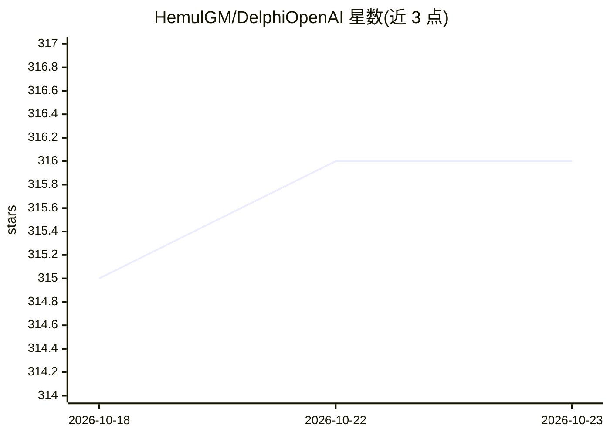

# HemulGM/DelphiOpenAI

⭐ 316 · Pascal · MIT · 推送 2026-07-14 · [GitHub](https://github.com/HemulGM/DelphiOpenAI) · 个人维护

**Delphi 语言的 OpenAI 兼容 API 封装库**

为 Delphi（10.3+）实现的 OpenAI 公共 API 非官方封装库，无第三方依赖，覆盖 Models、Completions、Chat（含流式与 Vision）、Images（DALL-E）与 Function Calling 等接口，并提供异常类型、代理设置与第三方 API 预处理机制（IAPIPrepare）。兼容 Azure OpenAI、DeepSeek、YandexGPT、Qwen、GigaChat 等 OpenAI 兼容 API。通过 GetIt 包管理器或添加库路径安装，面向在 Delphi 应用中接入 LLM 服务的开发者；README 提示客户端应用中使用会暴露 API key。

## 筛选速览

| 维度 | 判定 | 备注 |
|---|---|---|
| AI 角色 | `ai-ecosystem` | LLM/agent 周边工具 |
| 许可风险 | `permissive` | MIT |
| 部署形态 | `None` |  |
| 模型依赖 | — | README 未给出锁定关系 |
| 硬件要求 | — | 无带数字的原话,不猜 |
| 安装摩擦 | `low` | 无编译、无系统依赖或容器化 |
| 成熟度 | — | 结构信号不足 |

## 能力要点

- 覆盖 Chat/Completions/Images/Models/Function Calling 等 OpenAI 接口
- 支持流式输出与 Vision 输入
- 代理设置与 IAPIPrepare 第三方 API 预处理机制（如 GigaChat 认证）
- 兼容 DeepSeek、Azure OpenAI、YandexGPT、Qwen、GigaChat 等 API

## 适用场景

- 在 Delphi 应用中调用 OpenAI Chat、DALL-E 等服务
- 通过同一套封装切换到 DeepSeek、GigaChat 等 OpenAI 兼容 API
- 为 Delphi 桌面或跨平台应用添加对话与图像生成能力

## 场景标签

`模型网关` · 领域:Agent 开发

## 证据(README 行号)

> L11: This repositorty contains Delphi implementation over OpenAI public API.
> L16: Also, the library is compatible with the following AI APIs (tested):

## 星数曲线

2026-10-18 315 → 2026-10-23 316（+1）

---
*卡片 v1 · prompt 1.4 · 生成 2026-10-21 · 置信度 high · 依据 README sha `4125e30ee8be` · [字段定义](../../DATASET.md)*
