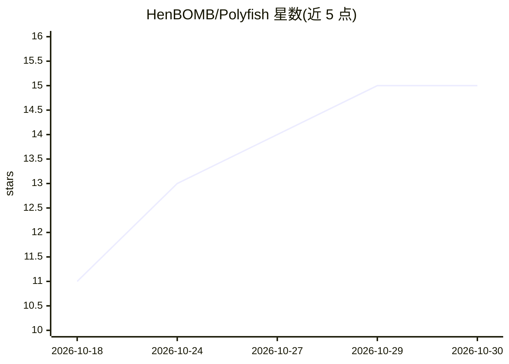

# HenBOMB/Polyfish

⭐ 15 · Rust · NOASSERTION · 推送 2026-10-24 · [GitHub](https://github.com/HenBOMB/Polyfish) · 个人维护

**Polytopia 游戏的 Rust AI 引擎：AlphaZero 式自博弈训练与实时状态提取**

用 Rust 重写 Polytopia 游戏逻辑的项目，包含混合 MCTS + 神经网络（Gumbel Alpha-Zero）的 AI 引擎，通过自博弈训练模型；配套 Web 模拟器 UI、训练仪表盘、冻结锚点 Elo 天梯评测，以及 C++ 注入脚本从 Steam 版游戏中提取实时状态。训练管线为 Rust 自博弈生成数据 + PyTorch 训练，三种推理后端（candle/tch/MPSGraph）共享同一模型文件。限制：训练仍需大量算力；状态提取器需 g++ 与 sudo 且不在仓库内。

## 筛选速览

| 维度 | 判定 | 备注 |
|---|---|---|
| AI 角色 | `ai-native` | 本体是模型或模型工具 |
| 许可风险 | `none` | NOASSERTION |
| 部署形态 | `desktop` | 安装包/桌面程序 |
| 模型依赖 | — | README 未给出锁定关系 |
| 硬件要求 | — | 无带数字的原话,不猜 |
| 安装摩擦 | `medium` | 含编译或系统依赖之一 |
| 成熟度 | — | 结构信号不足 |

## 能力要点

- Gumbel Alpha-Zero 搜索 + candle ResNet 网络的自博弈训练
- 三种推理后端（candle/tch/MPSGraph）读取同一 model.safetensors
- 冻结锚点 Elo 天梯与平台期早停接入训练循环
- C++ 内存读取器从 Steam 版提取实时游戏状态为 JSON

## 适用场景

- 训练并评测能玩 Polytopia 的 AI 模型
- 在 Web 模拟器中交互体验游戏与查看训练数据
- 从 Steam 版对局提取实时状态用于分析

## 场景标签

`模型训练` · 领域:训练与推理

## 证据(README 行号)

> L8: - **AI Engine**: A hybrid MCTS (Monte Carlo Tree Search) + Neural Network (Alpha-Zero style) approach, trained by se
> L3: An `AI NN` + MCTS `Rust` capable of playing the award winning `Polytopia` strategy game.

## 星数曲线

2026-10-18 11 → 2026-10-30 15（+4）

---
*卡片 v1 · prompt 1.4 · 生成 2026-10-30 · 置信度 high · 依据 README sha `ba3e6b095bca` · [字段定义](../../DATASET.md)*
