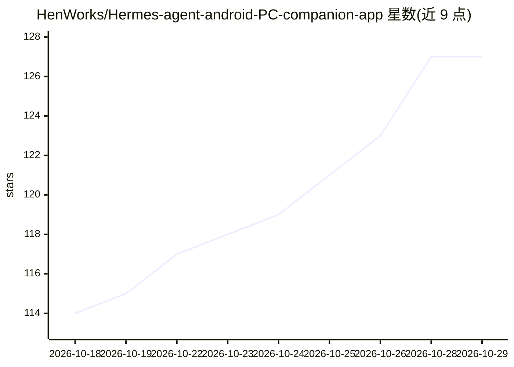

# HenWorks/Hermes-agent-android-PC-companion-app

⭐ 127 · Python · AGPL-3.0 · 推送 2026-09-04 · [GitHub](https://github.com/HenWorks/Hermes-agent-android-PC-companion-app) · 组织维护 · 中文 README

**Hermes-agent 手机应用的 PC 伴侣：跨设备跑任务与会话接力**

作为 Hermes-agent Android 应用的桌面端半件，通过本地网络（无云端）连接手机与电脑：mesh 能力允许从手机派发任务由电脑上的 Hermes 执行并回传结果；Desktop Handoff 在两端间迁移会话，采用幂等合并（按 id upsert 与自然键去重）避免重复。安全上使用 NaCl Box 端到端加密，配对通过现场扫码交换公钥，私钥不离开设备，broker 仅绑定局域网/Tailscale IP。以预编译二进制或源码（Python 3 + PyNaCl 等）方式运行。

## 筛选速览

| 维度 | 判定 | 备注 |
|---|---|---|
| AI 角色 | `ai-ecosystem` | LLM/agent 周边工具 |
| 许可风险 | `viral` | AGPL-3.0 |
| 部署形态 | `None` |  |
| 模型依赖 | — | README 未给出锁定关系 |
| 硬件要求 | — | 无带数字的原话,不猜 |
| 安装摩擦 | `low` | 无编译、无系统依赖或容器化 |
| 成熟度 | — | 结构信号不足 |

## 能力要点

- mesh：手机派发任务、电脑端 Hermes 执行并回传
- Desktop Handoff：会话双向迁移，幂等合并不产生重复
- NaCl Box 端到端加密，一次性扫码配对，私钥不离开设备
- 预编译独立二进制，无需 Python 即可运行

## 适用场景

- 出门在外时把电脑上的 Hermes 会话转给手机继续
- 让家里电脑替手机端 Hermes 跑任务并回传结果
- 在自有局域网内安全同步两端的 Hermes 会话数据

## 场景标签

`Agent 框架` `Agent 记忆` · 领域:Agent 开发

## 证据(README 行号)

> L5: The desktop companion for the **Hermes‑agent Android** app. It lets your phone and
> L11: - **Run on Computer (mesh)** — dispatch a task from your phone; your computer's Hermes
> L18: > This is the **PC half**. The phone half is the Hermes‑agent Android app.

## 星数曲线

2026-10-18 114 → 2026-10-29 127（+13）

---
*卡片 v1 · prompt 1.4 · 生成 2026-10-23 · 置信度 high · 依据 README sha `e04ca9d58929` · [字段定义](../../DATASET.md)*
