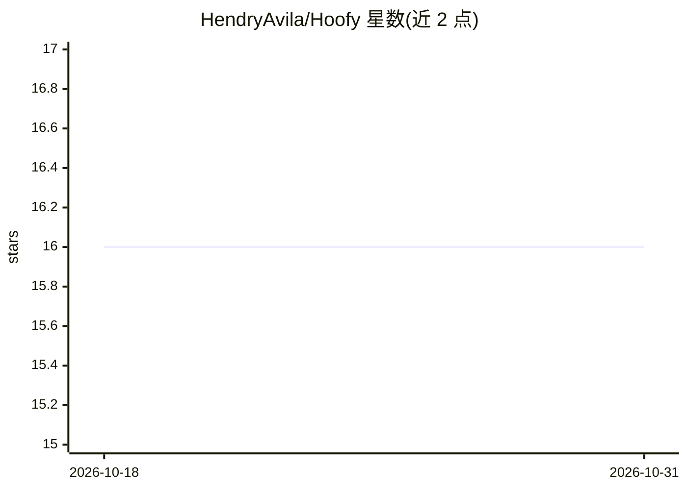

# HendryAvila/Hoofy

⭐ 16 · Go · MIT · 推送 2026-03-12 · [GitHub](https://github.com/HendryAvila/Hoofy) · [官网](https://hendrycode.xyz/blog/2026/2/25/hoofy-tu-companion-de-desarrollo-con-ia-que-no-te-deja-cortar-camino/) · 个人维护

**给 AI 编程助手的 MCP 服务器：持久记忆与规格驱动开发**

用 Go 编写的单个 MCP 服务器二进制，零外部运行时依赖，为 Claude Code、Cursor、VS Code Copilot、OpenCode、Gemini CLI 等 MCP 兼容工具提供 32 个工具：基于 SQLite+FTS5 的跨会话持久记忆与知识图谱、9 阶段新项目规格流水线（含 Clarity Gate 阻断模糊规格）、12 种按变更类型×规模自适应的变更管线，以及逆向工程既有代码库生成规格产物。同一时刻只允许一个活跃变更。另有 Claude Code 专属可选插件（agent/技能/hooks）。

## 筛选速览

| 维度 | 判定 | 备注 |
|---|---|---|
| AI 角色 | `ai-ecosystem` | LLM/agent 周边工具 |
| 许可风险 | `permissive` | MIT |
| 部署形态 | `library` | 以包/库形式分发 |
| 模型依赖 | — | README 未给出锁定关系 |
| 硬件要求 | — | 无带数字的原话,不猜 |
| 安装摩擦 | `low` | 无编译、无系统依赖或容器化 |
| 成熟度 | — | 结构信号不足 |

## 能力要点

- SQLite+FTS5 持久记忆与带类型边的知识图谱
- Clarity Gate 在实现前阻断模糊规格
- 变更管线按类型×规模自适应（12 种变体）
- sdd_reverse_engineer 逆向工程既有代码库生成规格

## 适用场景

- 让 AI 编程助手跨会话记住项目上下文与决策
- 以规格驱动流程约束 AI 先规划后编码
- 为没有规格的存量项目补建需求与设计文档

## 场景标签

`知识图谱` `Agent 记忆` · 领域:Agent 开发

## 证据(README 行号)

> L6:  An MCP server that gives your AI persistent memory, structured specifications,
> L26: - It works with Claude Code, Cursor, VS Code Copilot, OpenCode, Gemini CLI (and any MCP-compatible tool).
> L136:  > The **MCP server** is Hoofy itself — the binary you just installed. It provides memory, change pipeline, projec

## 星数曲线

2026-10-18 16 → 2026-10-31 16（+0）

---
*卡片 v1 · prompt 1.4 · 生成 2026-10-30 · 置信度 high · 依据 README sha `28e6312c11de` · [字段定义](../../DATASET.md)*
