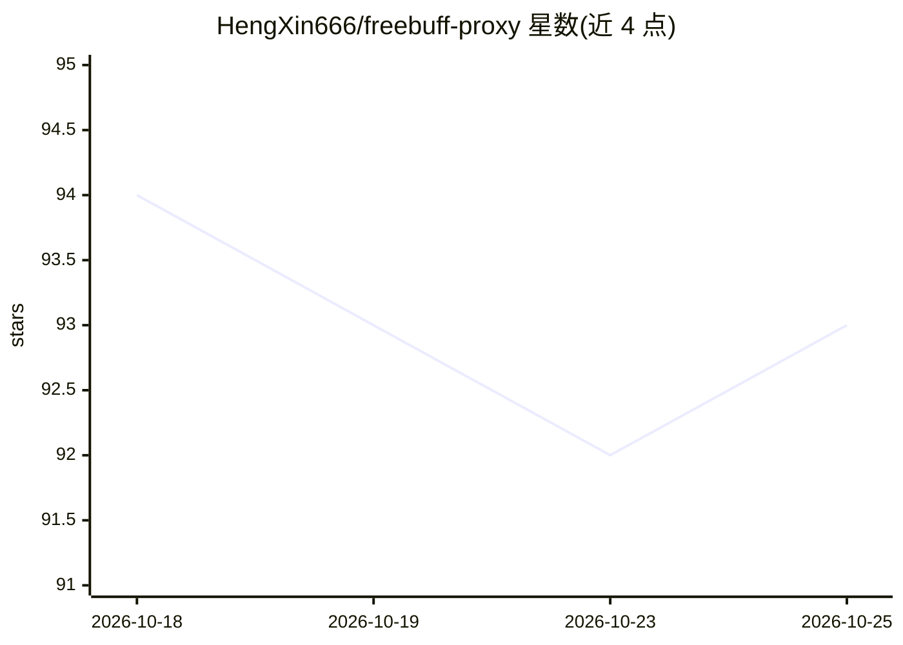

# HengXin666/freebuff-proxy

⭐ 93 · TypeScript · MIT · 推送 2026-10-18 · [GitHub](https://github.com/HengXin666/freebuff-proxy) · 个人维护 · 中文 README

**把 Freebuff 免费额度反代为 OpenAI 兼容 API 的自托管网关**

自托管代理服务：将 Freebuff 平台的免费额度封装为标准 OpenAI 兼容端点（/v1/chat/completions、/v1/models），下游 Agent 用 base_url+api_key+model 即可接入。服务负责 Freebuff 身份凭证多账号池、免费 session 准入与额度调度，流式/非流式响应原样透传；上游请求经 cli-bridge（官方同款 bun 执行）按官方客户端抓包真值发出。提供 Web 控制台管理账号、用户、API Key 与代理池；一键 Docker 部署（node:22-alpine 镜像，host 模式）。限制：每模型每日约 6 次、并发槽位 1，协议实现基于客户端逆向，需自行承担账号风险。

## 筛选速览

| 维度 | 判定 | 备注 |
|---|---|---|
| AI 角色 | `ai-ecosystem` | LLM/agent 周边工具 |
| 许可风险 | `permissive` | MIT |
| 部署形态 | `self-host` | docker 或自建部署 |
| 模型依赖 | — | README 未给出锁定关系 |
| 硬件要求 | — | 无带数字的原话,不猜 |
| 安装摩擦 | `low` | 无编译、无系统依赖或容器化 |
| 成熟度 | — | 结构信号不足 |

## 能力要点

- Freebuff 免费额度转 OpenAI 兼容 API，流式/非流式透传
- 多账号池调度、Freebucks 额度保护与超时自动中断
- Web 控制台管理账号/用户/API Key/代理，无需改配置文件
- 上游请求按官方客户端抓包真值经 cli-bridge 发出

## 适用场景

- 下游 Agent/应用免费接入 DeepSeek、GPT、Gemini 等模型的 API
- 用多账号池应对每模型每日次数限制
- 自建团队内共享 API Key 的网关

## 场景标签

`模型网关` · 领域:Agent 开发

## 证据(README 行号)

> L2:  把 Freebuff 的免费额度,变成一个 OpenAI 兼容的 API 端点.
> L14: 下游 Agent 只需要标准的 `base_url + api_key + model`,本服务负责 Freebuff 身份凭证(多账号池),免费 session 准入,协议形态与额度调度,并把**流式 / 非流式响应原样透传**

## 星数曲线

2026-10-18 94 → 2026-10-25 93（-1）

---
*卡片 v1 · prompt 1.4 · 生成 2026-10-23 · 置信度 high · 依据 README sha `99a2c675d266` · [字段定义](../../DATASET.md)*
