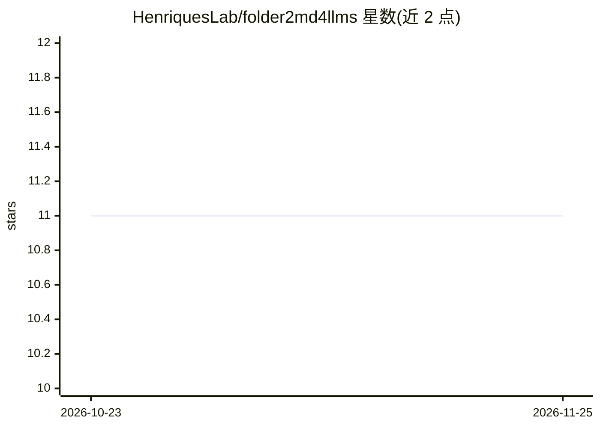

# HenriquesLab/folder2md4llms

⭐ 11 · Python · MIT · 推送 2026-07-14 · [GitHub](https://github.com/HenriquesLab/folder2md4llms) · 组织维护

**把文件夹内容合并为 LLM 友好单文件的转换工具**

命令行工具，读取任意目录结构，将其中文件合并为单个 Markdown 文本输出，供 LLM 使用。支持 PDF、DOCX、XLSX 等文档格式转文本，对图片、压缩包等二进制文件生成描述；可按 token 或字符上限压缩代码内容而非粗暴截断；支持 .gitignore 风格过滤、folder2md.yaml 配置与多线程并行处理。需 Python 3.11+，经 Homebrew、pipx 或 pip 安装，命令名为 folder2md。

## 筛选速览

| 维度 | 判定 | 备注 |
|---|---|---|
| AI 角色 | `ai-ecosystem` | LLM/agent 周边工具 |
| 许可风险 | `permissive` | MIT |
| 部署形态 | `library` | 以包/库形式分发 |
| 模型依赖 | — | README 未给出锁定关系 |
| 硬件要求 | — | 无带数字的原话,不猜 |
| 安装摩擦 | `low` | 无编译、无系统依赖或容器化 |
| 成熟度 | — | 结构信号不足 |

## 能力要点

- 按 token/字符上限智能压缩代码，避免粗暴截断
- PDF/DOCX/XLSX 等文档转文本，二进制文件生成描述
- .gitignore 风格过滤与 folder2md.yaml 配置
- 多线程并行处理，Homebrew/pipx/pip 多渠道分发

## 适用场景

- 把代码仓库整理成单个文本交给 LLM 分析
- 为上下文窗口准备受 token 限制的项目内容
- 批量转换文档为文本供 LLM 处理

## 场景标签

`文档解析` · 领域:知识与检索

## 证据(README 行号)

> L10: `folder2md4llms` is a configurable tool that converts any folder structure and its contents into a single, LLM-frie
> L15: - **Document Conversion**: Converts PDF, DOCX, XLSX, and other document formats into text.

## 星数曲线

2026-10-23 11 → 2026-11-25 11（+0）

---
*卡片 v1 · prompt 1.4 · 生成 2026-11-19 · 置信度 high · 依据 README sha `e9c988731514` · [字段定义](../../DATASET.md)*
