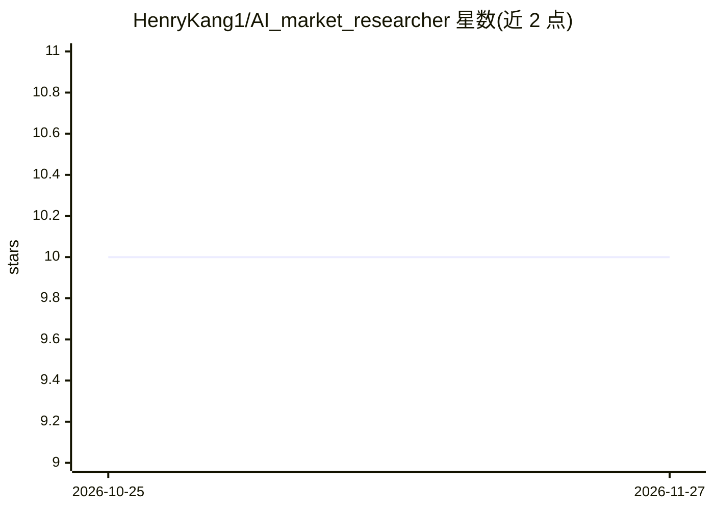

# HenryKang1/AI_market_researcher

⭐ 10 · TypeScript · MIT · 推送 2025-12-02 · [GitHub](https://github.com/HenryKang1/AI_market_researcher) · 个人维护

**为创业者自动生成与测试客户访谈问题的 AI 调研工具**

一个基于 Google AI Studio 的 Web 应用（AI Studio app），由创业者为自己测试客户访谈问卷而开发。功能上使用 Gemini API 运行 AI 调研，支持添加多个 persona（README 提及可添加 50、100 人），当前一次调查的提问数量上限为 10 个问题。安装方式为 npm install 安装依赖、在 .env.local 配置 GEMINI_API_KEY 后 npm run dev 本地运行，官方说明可申请免费的 Gemini API key（新 Google Cloud 账户 300 美元额度）。README 附韩语说明，作者同时在招募美国创业方向的协作者。

## 筛选速览

| 维度 | 判定 | 备注 |
|---|---|---|
| AI 角色 | `ai-native` | 本体是模型或模型工具 |
| 许可风险 | `permissive` | MIT |
| 部署形态 | `library` | 以包/库形式分发 |
| 模型依赖 | — | README 未给出锁定关系 |
| 硬件要求 | — | 无带数字的原话,不猜 |
| 安装摩擦 | `low` | 无编译、无系统依赖或容器化 |
| 成熟度 | — | 结构信号不足 |

## 能力要点

- 调用 Gemini API 生成/运行 AI 客户访谈调研
- 支持添加多个 persona，README 提及可加至 50-100 名
- README 给出申请免费 Gemini API key（300 美元新手额度）的指引
- 提供英文与韩文双语安装说明

## 适用场景

- 创业者在做客户访谈前测试问卷问题是否合适
- 以不同 persona 批量模拟受访者回答
- 在本地跑通一个基于 Gemini 的市场调研 demo

## 场景标签

 · 领域:市场调研/创业工具

## 证据(README 行号)

> L4: This is the app for the AI survey app. I run my own startup and I am tired to test the survey. So I make this survey
> L13: 2. Set the `GEMINI_API_KEY` in .env.local to your Gemini API key

## 星数曲线

2026-10-25 10 → 2026-11-27 10（+0）

---
*卡片 v1 · prompt 1.4 · 生成 2026-11-20 · 置信度 high · 依据 README sha `0188647cdb50` · [字段定义](../../DATASET.md)*
