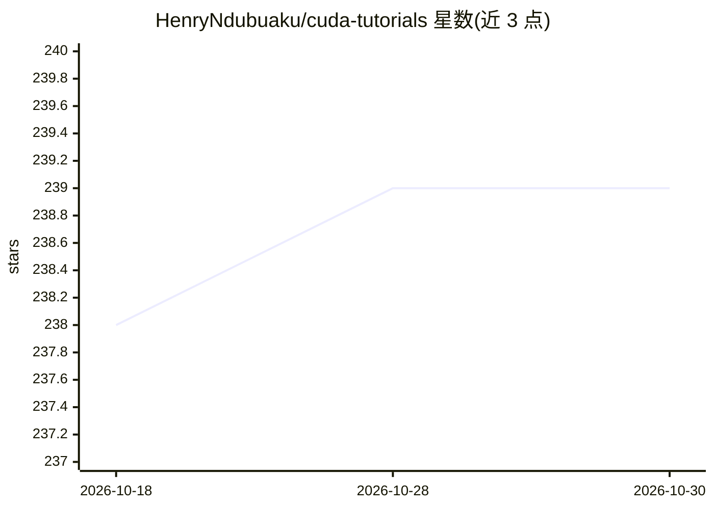

# HenryNdubuaku/cuda-tutorials

⭐ 239 · Cuda · MIT · 推送 2026-10-13 · [GitHub](https://github.com/HenryNdubuaku/cuda-tutorials) · 个人维护

**CUDA 并行编程教程集：面向数学与机器学习的从零到进阶**

由个人作者维护的 CUDA 教程仓库，内容从 GPU 架构（SM、SIMT、内存层级）、CUDA 编程模型（kernel、线程层级）讲起，延伸至数学与机器学习加速场景，源自作者 2016 年本科毕业论文的扩展。教程文件按学习顺序编号，每份附讲解，读者可用 nvcc 编译并运行任一示例文件，需自备 GPU 与相应库。属于知识型仓库，不含可安装的软件包。

## 筛选速览

| 维度 | 判定 | 备注 |
|---|---|---|
| AI 角色 | `ai-knowledge` | 知识聚合/清单类 |
| 许可风险 | `permissive` | MIT |
| 部署形态 | `None` |  |
| 模型依赖 | — | README 未给出锁定关系 |
| 硬件要求 | — | 无带数字的原话,不猜 |
| 安装摩擦 | `medium` | 含编译或系统依赖之一 |
| 成熟度 | — | 结构信号不足 |

## 能力要点

- 按进阶顺序编号的教程文件，每份附概念讲解
- 覆盖 GPU 架构、内存层级与 CUDA 线程模型基础
- 示例可用 nvcc 一行命令编译运行

## 适用场景

- 系统学习 CUDA 并行编程以编写 GPU kernel
- 了解 GPU 架构与内存层级概念
- 为数学/机器学习计算做 GPU 加速入门

## 场景标签

`教程课程` · 领域:学习与行业

## 证据(README 行号)

> L3: # Zero to hero CUDA for accelerated maths and machine learning: Extended from my bachelors dissertation (2016).
> L78: The files are numbered by progression order and thoroughy explained, simply read through to understand each concept

## 星数曲线

2026-10-18 238 → 2026-10-30 239（+1）

---
*卡片 v1 · prompt 1.4 · 生成 2026-10-22 · 置信度 high · 依据 README sha `188c84403fd2` · [字段定义](../../DATASET.md)*
