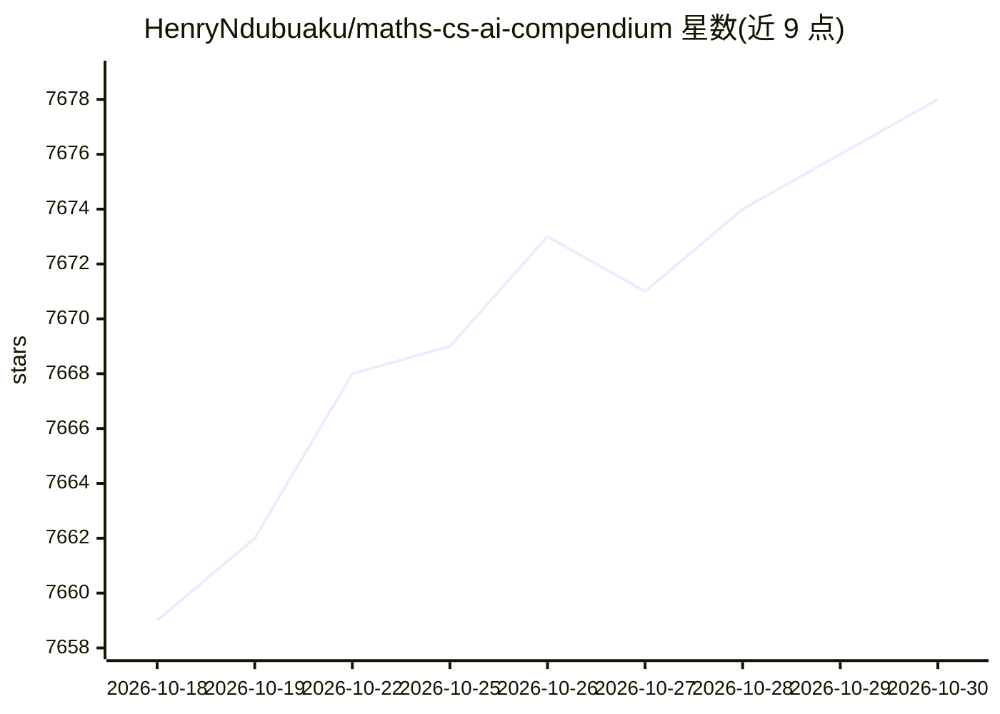

# HenryNdubuaku/maths-cs-ai-compendium

⭐ 7,678 · TypeScript · Apache-2.0 · 推送 2026-07-18 · [GitHub](https://github.com/HenryNdubuaku/maths-cs-ai-compendium) · 个人维护

**覆盖数学、计算机与 AI 的开放教科书，供深入学习用**

由 Henry Ndubuaku 个人维护的开放式教科书，从向量、矩阵、微积分等数学基础到 NLP、计算机视觉、GNN、GPU 编程、AI 推理、ML 系统设计共 18 章，以直觉优先的方式讲解。面向希望深入理解原理而非应试的开发者与研究者，入门仅需初等数学与基础 Python。仓库另含一个 MCP server，可让 Claude Code、Cursor 等 AI 助手将全书用作知识库，需本地克隆仓库后运行。支持在线阅读与 BibTeX 引用。

## 筛选速览

| 维度 | 判定 | 备注 |
|---|---|---|
| AI 角色 | `ai-knowledge` | 知识聚合/清单类 |
| 许可风险 | `permissive` | Apache-2.0 |
| 部署形态 | `None` |  |
| 模型依赖 | — | README 未给出锁定关系 |
| 硬件要求 | — | 无带数字的原话,不猜 |
| 安装摩擦 | `medium` | 含编译或系统依赖之一 |
| 成熟度 | — | 结构信号不足 |

## 能力要点

- 18 章覆盖数学基础到 ML 系统设计与 GPU 编程
- 附 MCP server，可让 AI 助手（Claude Code/Cursor/VS Code）把全书作为知识库
- 支持在线阅读与 BibTeX 引用
- 前置知识仅需初等数学与基础 Python

## 适用场景

- 系统学习 AI/ML 所需的数学与计算基础
- 为 AI 编程助手挂载全书作为可检索知识库
- 面试或研究前按目录补齐特定领域知识

## 场景标签

`教程课程` · 领域:学习与行业

## 证据(README 行号)

> L10: Most textbooks bury good ideas under dense notation, skip the intuition, assume you already know half the material,
> L16: This repo includes an MCP server that lets any AI assistant (Claude Code, Cursor, VS Code, etc.) use the compendium
> L20: |#|Chapter|Summary|Status|

## 星数曲线

2026-10-18 7,659 → 2026-10-30 7,678（+19）

---
*卡片 v1 · prompt 1.4 · 生成 2026-10-20 · 置信度 high · 依据 README sha `596c9702cdbf` · [字段定义](../../DATASET.md)*
