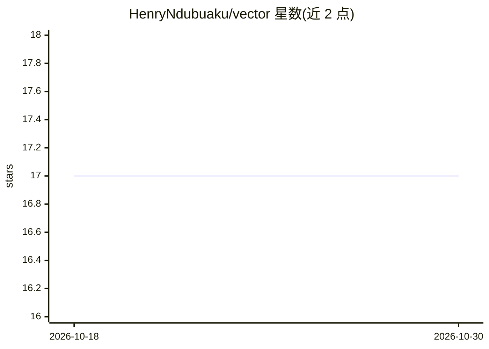

# HenryNdubuaku/vector

⭐ 17 · Rust · Apache-2.0 · 推送 2026-09-20 · [GitHub](https://github.com/HenryNdubuaku/vector) · 个人维护

**面向机器学习的函数式编程语言，经 XLA 编译到 CPU/GPU/TPU**

Vector 是一门 Pythonic 语法、函数式范式的编程语言，将整个程序（不仅是训练循环）编译为 XLA 上的单一算子，运行于 CPU、Nvidia GPU、AMD GPU、Apple GPU 与 TPU。提供类 PyTorch nn.Module 的模块系统、safetensors 权重保存、StableHLO 模型导出、HTTP 服务命令、CSV 表格与 matplotlib 风格绘图、图像与音频处理等内置能力。通过 install.sh 脚本安装，附带 GPT 与视觉 Transformer 示例及语言参考文档。

## 筛选速览

| 维度 | 判定 | 备注 |
|---|---|---|
| AI 角色 | `ai-ecosystem` | LLM/agent 周边工具 |
| 许可风险 | `permissive` | Apache-2.0 |
| 部署形态 | `None` |  |
| 模型依赖 | — | README 未给出锁定关系 |
| 硬件要求 | — | 无带数字的原话,不猜 |
| 安装摩擦 | `low` | 无编译、无系统依赖或容器化 |
| 成熟度 | — | 结构信号不足 |

## 能力要点

- 整程序编译为单一 XLA 算子，支持 CPU/Nvidia/AMD/Apple GPU 与 TPU
- 模块系统类 PyTorch nn.Module，权重存取为 safetensors
- 前向传播可导出 StableHLO 并用 `vector serve` 经 HTTP 部署
- 内置表格（CSV）、绘图（SVG）、图像与音频处理

## 适用场景

- 我想用一门语言写完整 ML 程序并全程跑在加速器上
- 把训练好的模型导出 StableHLO 并通过 HTTP 提供推理服务
- 在 CPU、GPU 或 TPU 机器间用同一份代码切换运行

## 场景标签

`模型训练` `推理引擎` · 领域:训练与推理

## 证据(README 行号)

> L5: A programming language for machine learning, compiled to CPUs, GPUs and TPUs through XLA.
> L9: Vector brings JAX-level speed across the entire program with Pythonic-syntax and functional paradigm, your entire co

## 星数曲线

2026-10-18 17 → 2026-10-30 17（+0）

---
*卡片 v1 · prompt 1.4 · 生成 2026-10-30 · 置信度 mid · 依据 README sha `a5a26d1ec136` · [字段定义](../../DATASET.md)*
