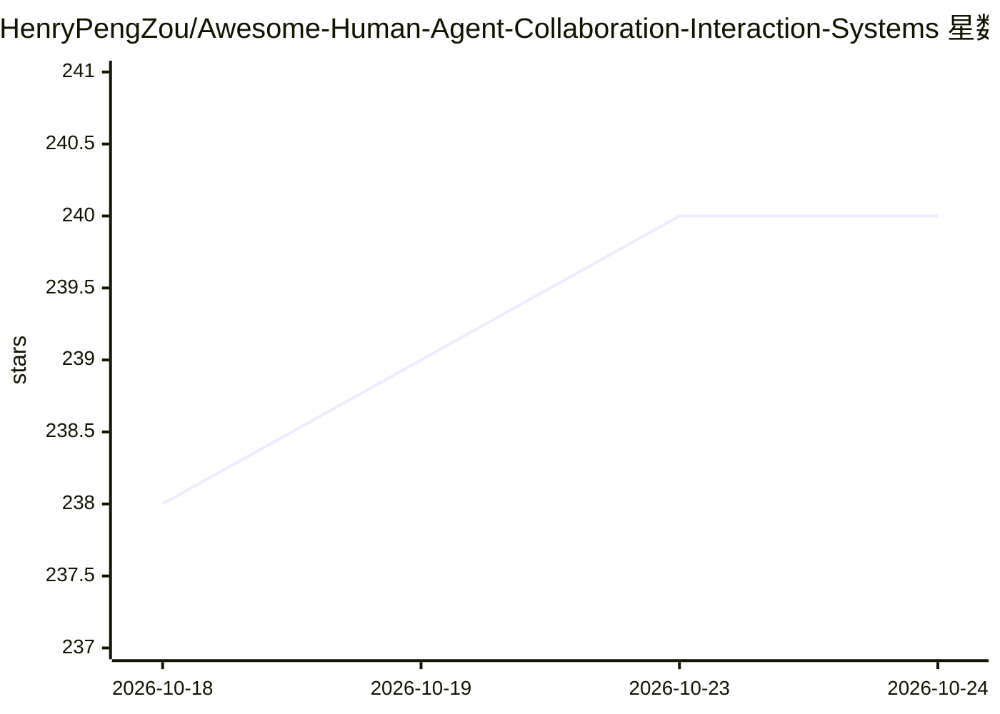

# HenryPengZou/Awesome-Human-Agent-Collaboration-Interaction-Systems

⭐ 240 · 推送 2026-07-23 · [GitHub](https://github.com/HenryPengZou/Awesome-Human-Agent-Collaboration-Interaction-Systems) · [官网](https://arxiv.org/abs/2505.00753) · 组织维护 · 中文 README

**LLM 人机协作与交互系统研究综述配套的论文资源清单**

ACL 2026 综述论文 'LLM-Based Human-Agent Collaboration and Interaction Systems' 的配套资源仓库：面向人机协作方向的研究者，按时间倒序收录 2024-2026 年约 70 篇相关论文（多为 arXiv 预印本，含 ICML/ICLR/ACL 等会议论文），部分条目附 GitHub 代码仓库或项目主页链接。内容覆盖人类反馈训练、主动式 agent、human-in-the-loop 工作流、多智能体协作、用户模拟等子方向。仅是文献编目，无可运行代码，通过提交 PR/issue 贡献条目，声明持续更新。

## 筛选速览

| 维度 | 判定 | 备注 |
|---|---|---|
| AI 角色 | `ai-knowledge` | 知识聚合/清单类 |
| 许可风险 | `none` | — |
| 部署形态 | `None` |  |
| 模型依赖 | — | README 未给出锁定关系 |
| 硬件要求 | — | 无带数字的原话,不猜 |
| 安装摩擦 | `low` | 无编译、无系统依赖或容器化 |
| 成熟度 | — | 结构信号不足 |

## 能力要点

- ACL 2026 综述论文的配套资源仓库
- 按时间倒序收录 2024-2026 年约 70 篇论文条目
- 部分条目附 GitHub 代码仓库或项目主页链接
- 开放 PR/issue 贡献并声明持续更新

## 适用场景

- 查找人机协作与 LLM agent 交互方向的最新论文
- 为相关研究选题做文献调研
- 通过附带的代码仓库链接复现论文工作

## 场景标签

`精选清单` `科研工具` · 领域:学习与行业

## 证据(README 行号)

> L17: Welcome to Awesome-Human-Agent-Collaboration-Interaction-Systems! 🚀 This is the repo for our Survey on LLM-Based Hu
> L23: **LLM-based human-agent collaboration systems are interactive frameworks where humans actively provide** ***(1) add
> L25: Our goal with this project is to build an exhaustive collection of awesome resources relevant to LLM-Based Human-Ag

## 星数曲线

2026-10-18 238 → 2026-10-24 240（+2）

---
*卡片 v1 · prompt 1.4 · 生成 2026-10-23 · 置信度 high · 依据 README sha `37585f0b081e` · [字段定义](../../DATASET.md)*
