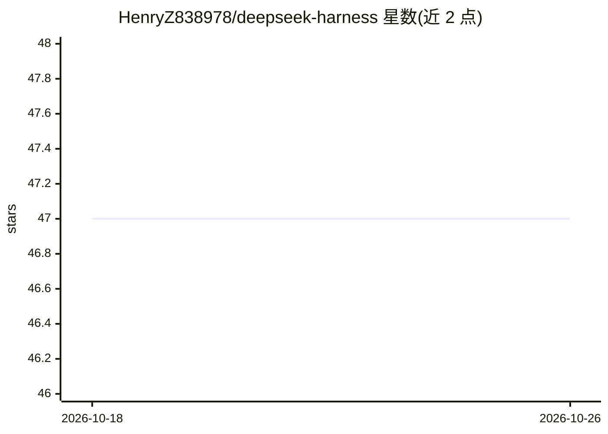

# HenryZ838978/deepseek-harness

⭐ 47 · Python · MIT · 推送 2026-09-10 · [GitHub](https://github.com/HenryZ838978/deepseek-harness) · [官网](https://github.com/HenryZ838978/deepseek-harness) · 个人维护 · 中文 README

**DeepSeek V4 协议适配与验证工具包：Python 库+CLI+MCP+Skill 四形态**

针对 DeepSeek V4-Pro/V4-Flash OpenAI 兼容 API 的协议适配层：将 16 项已实证的线上协议行为（reasoning_content 往返、默认思考模式 token 消耗、前缀缓存 256-token 块对齐、1,048,576-token 硬上下文上限等）编码为 spec/ 契约，并以同一契约分发 Python 库、dsh CLI、MCP server 与 Anthropic Skill 四种形态。CLI 提供 11 项 doctor 探针，检测官方 Node 运行时（@deepseek-ai/dsh）的已知静默故障并给出修复建议。仓库声明独立于官方项目，首发于 2026-05-11。

## 筛选速览

| 维度 | 判定 | 备注 |
|---|---|---|
| AI 角色 | `ai-ecosystem` | LLM/agent 周边工具 |
| 许可风险 | `permissive` | MIT |
| 部署形态 | `library` | 以包/库形式分发 |
| 模型依赖 | locked-api |  |
| 硬件要求 | — | 无带数字的原话,不猜 |
| 安装摩擦 | `low` | 无编译、无系统依赖或容器化 |
| 成熟度 | — | 结构信号不足 |

## 能力要点

- 单一协议契约分发为 Python 库/CLI/MCP server/Skill 四种形态
- dsh doctor 提供 11 项针对官方 Node 运行时的故障探针
- 16 项协议行为各配可复现探针与社区引用
- 前缀缓存命中可将输入成本降低约 50 倍的实测数据

## 适用场景

- Python agent 项目中正确处理 DeepSeek 的 reasoning_content 往返与流式协议
- CI 或命令行环境中诊断 DeepSeek 接入的静默故障
- 为 Claude Code / MCP 客户端挂载 DeepSeek 协议适配能力

## 场景标签

`模型网关` `LLM 可观测性` · 领域:Agent 开发

## 证据(README 行号)

> L197: The goal of this repository is to characterize each behaviour with a reproducible probe, codify the resulting cont
> L82: Agent framework: `npx @deepseek-ai/dsh` · This: `pip install deepseek-harness-cli && dsh doctor`

## 星数曲线

2026-10-18 47 → 2026-10-26 47（+0）

---
*卡片 v1 · prompt 1.4 · 生成 2026-10-25 · 置信度 mid · 依据 README sha `f48ea54f4c98` · [字段定义](../../DATASET.md)*
