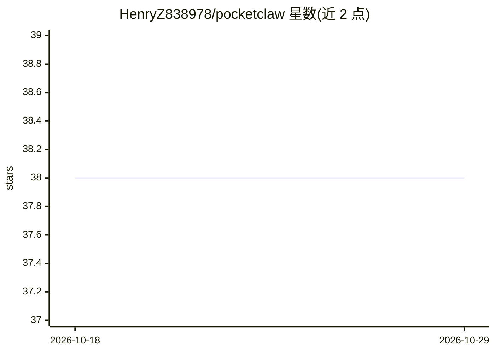

# HenryZ838978/pocketclaw

⭐ 38 · Kotlin · 推送 2026-03-17 · [GitHub](https://github.com/HenryZ838978/pocketclaw) · 个人维护 · 中文 README

**安卓手机本地运行的 AI agent 应用：单 APK 免服务器**

面向手机用户的 serverless AI agent 应用：单个 APK 安装于 Android 手机，提供聊天界面、16 个内置工具（文件/剪贴板/网页搜索/日程/应用启动/Telegram 发送/屏幕操作）、四级权限安全体系（PermissionGuard/PathSandbox/RateLimiter/AuditLog）与自定义技能。双模式大脑：本地 Qwen3-1.7B 经 llama.cpp 离线运行，或一键切换 DashScope 云 API（MiniMax-M2.5）；含记忆系统（Bond 五阶段成长）、STT/TTS 与 4 平台消息桥。v0.4.1 debug 版 APK 约 420MB。

## 筛选速览

| 维度 | 判定 | 备注 |
|---|---|---|
| AI 角色 | `ai-native` | 本体是模型或模型工具 |
| 许可风险 | `permissive` | — |
| 部署形态 | `None` |  |
| 模型依赖 | — | README 未给出锁定关系 |
| 硬件要求 | — | 无带数字的原话,不猜 |
| 安装摩擦 | `low` | 无编译、无系统依赖或容器化 |
| 成熟度 | `idea` | |

## 能力要点

- 单 APK 安装，无需服务器/Docker/API key，Qwen3-1.7B 本地离线推理
- 16 个内置工具配 L0-L3 四级权限与路径沙箱、限流、审计日志
- 本地 LLM 与 DashScope 云 API 一键切换
- Bond 记忆系统存储偏好/习惯/关系，分 5 个成长阶段

## 适用场景

- 在手机上离线使用能执行操作的 AI 助手
- 通过对话添加自定义技能（如网页搜索）
- 让 agent 代为读文件、开应用、发 Telegram 消息等日常操作

## 场景标签

`AI 助手` · 领域:对话与助手

## 证据(README 行号)

> L5: **A serverless, mobile-native AI agent.**
> L100: |**Model**|Qwen3-1.7B (Q8_0)|MiniMax-M2.5|
> L101: |**Runs on**|Your phone (llama.cpp)|DashScope API|

## 星数曲线

2026-10-18 38 → 2026-10-29 38（+0）

---
*卡片 v1 · prompt 1.4 · 生成 2026-10-25 · 置信度 high · 依据 README sha `e941ee875f0b` · [字段定义](../../DATASET.md)*
