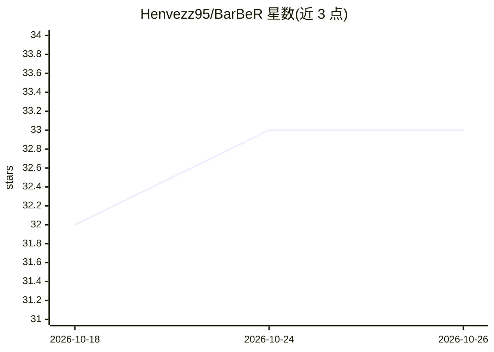

# Henvezz95/BarBeR

⭐ 33 · C++ · AGPL-3.0 · 推送 2025-11-25 · [GitHub](https://github.com/Henvezz95/BarBeR) · 组织维护

**1D/2D 条码定位算法的基准测试仓库与工具集**

收录历届论文提出的多种 1D 与 2D 条码定位算法实现（含 Detectron2、PyTorch、Ultralytics YOLO/RT-DETR 及多个经典方法的复现），并提供统一数据集、预训练模型与基准测试工具：单类/多类检测指标（precision/recall/F1/mAP）、推理时间基准、基于 pyzbar 的解码率端到端评测，以及 K 折交叉验证脚本与自研 BaFaLo 分割架构训练代码。面向计算机视觉研究者，需 CMake 编译 C++ 库并安装 OpenCV/Boost 等系统依赖，主要在 Linux 开发，x86-64 与 ARM 均有测试。

## 筛选速览

| 维度 | 判定 | 备注 |
|---|---|---|
| AI 角色 | `ai-native` | 本体是模型或模型工具 |
| 许可风险 | `viral` | AGPL-3.0 |
| 部署形态 | `library` | 以包/库形式分发 |
| 模型依赖 | — | README 未给出锁定关系 |
| 硬件要求 | — | 无带数字的原话,不猜 |
| 安装摩擦 | `medium` | 含编译或系统依赖之一 |
| 成熟度 | — | 结构信号不足 |

## 能力要点

- 收录多个论文条码定位算法的统一 Python 实现与预训练模型
- 提供单类/多类检测、推理时间、解码率四类基准测试
- 支持 K 折交叉验证的自动化 bash 脚本
- 包含自研 BaFaLo 分割架构的 PyTorch 定义与训练代码

## 适用场景

- 对比不同条码定位算法在我的数据上的精度与速度
- 复现论文中的条码定位基准结果
- 按仓库框架接入并评测自己的新定位算法

## 场景标签

`模型评测` `目标检测` · 领域:评测与运维

## 证据(README 行号)

> L2: The repository contains multiple algorithms for 1D and 2D barcode localization proposed in different papers in the p
> L58:  - test_single_class.py: runs a set of detection algorithms on the test set, considering only barcodes of one class

## 星数曲线

2026-10-18 32 → 2026-10-26 33（+1）

---
*卡片 v1 · prompt 1.4 · 生成 2026-10-25 · 置信度 high · 依据 README sha `ee5f0fef2795` · [字段定义](../../DATASET.md)*
