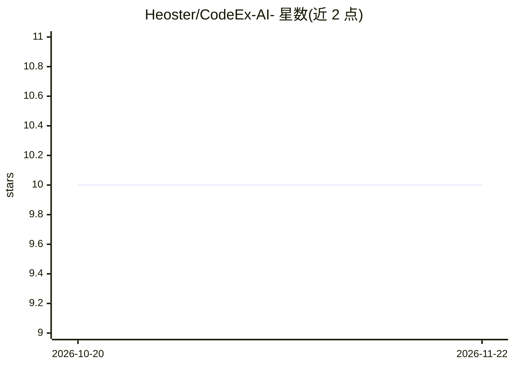

# Heoster/CodeEx-AI-

⭐ 10 · TypeScript · MIT · 推送 2026-11-13 · [GitHub](https://github.com/Heoster/CodeEx-AI-) · [官网](https://codeex-ai.vercel.app) · 个人维护

**面向终端用户的免费 AI 聊天平台，聚合 35+ 模型**

基于 Next.js 14 的 Web 聊天平台，聚合 Groq、Google Gemini、Cerebras、Hugging Face 四家服务商的 35+ 模型，提供流式对话、联网搜索与来源引用、PDF 问答（≤5MB）、图片公式识别与分步解答、Edge TTS 语音、笔记导出（TXT/MD/PDF）等功能。前端 TypeScript + Tailwind + shadcn/ui，后端使用 Firebase（Auth/Firestore/Storage）。用户需自行申请各服务商免费 API key 写入环境变量后本地运行或部署到 Netlify/Vercel；支持 PWA 安装与离线缓存。

## 筛选速览

| 维度 | 判定 | 备注 |
|---|---|---|
| AI 角色 | `ai-native` | 本体是模型或模型工具 |
| 许可风险 | `permissive` | MIT |
| 部署形态 | `library` | 以包/库形式分发 |
| 模型依赖 | locked-api |  |
| 硬件要求 | — | 无带数字的原话,不猜 |
| 安装摩擦 | `low` | 无编译、无系统依赖或容器化 |
| 成熟度 | — | 结构信号不足 |

## 能力要点

- 聚合 4 家服务商 35+ 模型，多服务商适配器架构
- PDF 问答、图片公式识别与分步解答、联网搜索引用
- Edge TTS 语音合成与 PWA 安装、离线支持
- API key 全部服务端存放，含速率限制与 CSP 等安全配置

## 适用场景

- 免费使用多家服务商的模型进行对话与写代码
- 上传 PDF 让 AI 做文档问答与摘要
- 拍照识别数学方程并获取分步解法
- 以 PWA 形式在手机/桌面安装使用 AI 助手

## 场景标签

`聊天机器人` `AI 助手` `文档问答` `语音合成` · 领域:对话与助手

## 证据(README 行号)

> L16: SOHAM is a **100% free** AI chat platform featuring **35+ models** from leading providers: Groq (Llama 3.3 70B), Go
> L62: #### 💬 AI Chat
> L238: ### AI Integration

## 星数曲线

2026-10-20 10 → 2026-11-22 10（+0）

---
*卡片 v1 · prompt 1.4 · 生成 2026-11-20 · 置信度 high · 依据 README sha `2f6fdb4e31cf` · [字段定义](../../DATASET.md)*
