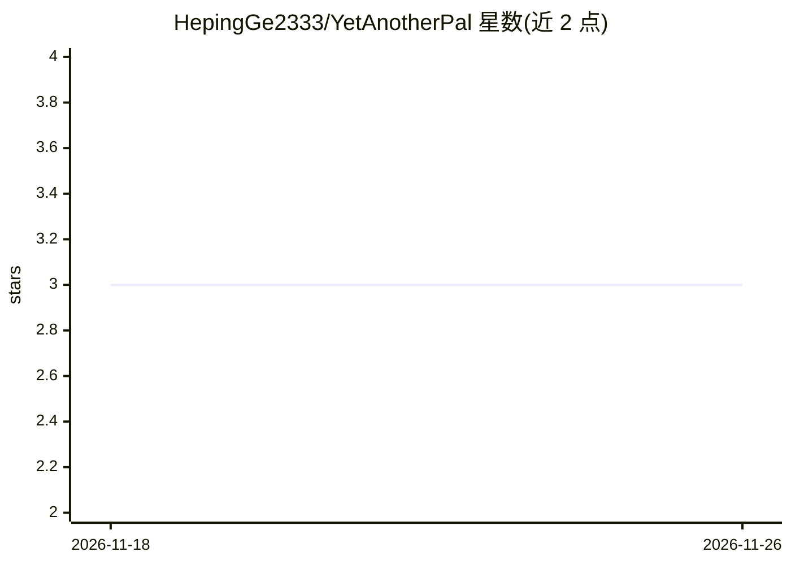

# HepingGe2333/YetAnotherPal

⭐ 3 · Kotlin · Apache-2.0 · 推送 2026-11-23 · [GitHub](https://github.com/HepingGe2333/YetAnotherPal) · 个人维护 · 中文 README

**Android+iOS 双端 AI 陪伴应用：把人格建模成长期联系人**

Yap 是一个 Android（Kotlin/Compose）+ iOS（SwiftUI）双端共享数据模型的 AI 陪伴应用，将人格建模为长期存在的联系人而非聊天参数。核心机制包括：记忆自动抽取与生命周期管理、工具执行器（recall/web_search/defer_reply 等）、30 秒心跳驱动的主动行为、睡眠与唤醒规则。模型接入任意 OpenAI 兼容服务；决策层 agentcore 零第三方依赖，默认本机运行、零网络，可切远程 agentd。发布包不含安装包，需从源码构建；iOS 后台行为受系统调度限制。

## 筛选速览

| 维度 | 判定 | 备注 |
|---|---|---|
| AI 角色 | `ai-native` | 本体是模型或模型工具 |
| 许可风险 | `permissive` | Apache-2.0 |
| 部署形态 | `None` |  |
| 模型依赖 | — | README 未给出锁定关系 |
| 硬件要求 | — | 无带数字的原话,不猜 |
| 安装摩擦 | `high` | 编译与系统依赖俱全 |
| 成熟度 | `idea` | |

## 能力要点

- 双端共享数据库 schema、备份格式与 Agent 契约，备份可互读
- 长期记忆：自动抽取、生命周期、分量衰减与 recall 三档检索
- 工具执行器（remember/web_search/defer_reply 等）与本地参考服务可离线联调
- 仅统计 token 用量，无金额额度与拦截

## 适用场景

- 在自己设备上运行一个长期记忆的本地优先 AI 陪伴应用
- 自建 OpenAI 兼容服务接入多套模型配置
- 研究跨端共享数据契约与 Agent 决策层架构

## 场景标签

`聊天机器人` `Agent 记忆` `模型网关` · 领域:Agent 开发

## 证据(README 行号)

> L5: YetAnotherPal（Yap）是一个 Android + iOS 的 AI 陪伴应用：把「人格」建模成长期存在的联系人，而不是一组可调的聊天参数。两端共享同一套数据模型、同一套行为约定和同一份备份文件；应用显示名为 **Yap
> L43: |模型接入|任意 OpenAI 兼容服务：多套配置、Base URL / Key / 模型 / 自定义 Headers、连通性测试、推理参数；Gemini 与 Claude 原生适配已预留|
> L83: 决策层只有一份实现：`agentcore/`（`:agentcore`，零第三方依赖）被 `:app` 与 `agentd/` 同时依赖。`agentd/` 在此之上加一层 HTTP（仅 JDK `com.sun.net.http

## 星数曲线

2026-11-18 3 → 2026-11-26 3（+0）

---
*卡片 v1 · prompt 1.4 · 生成 2026-11-22 · 置信度 high · 依据 README sha `9ac5cf9821f5` · [字段定义](../../DATASET.md)*
