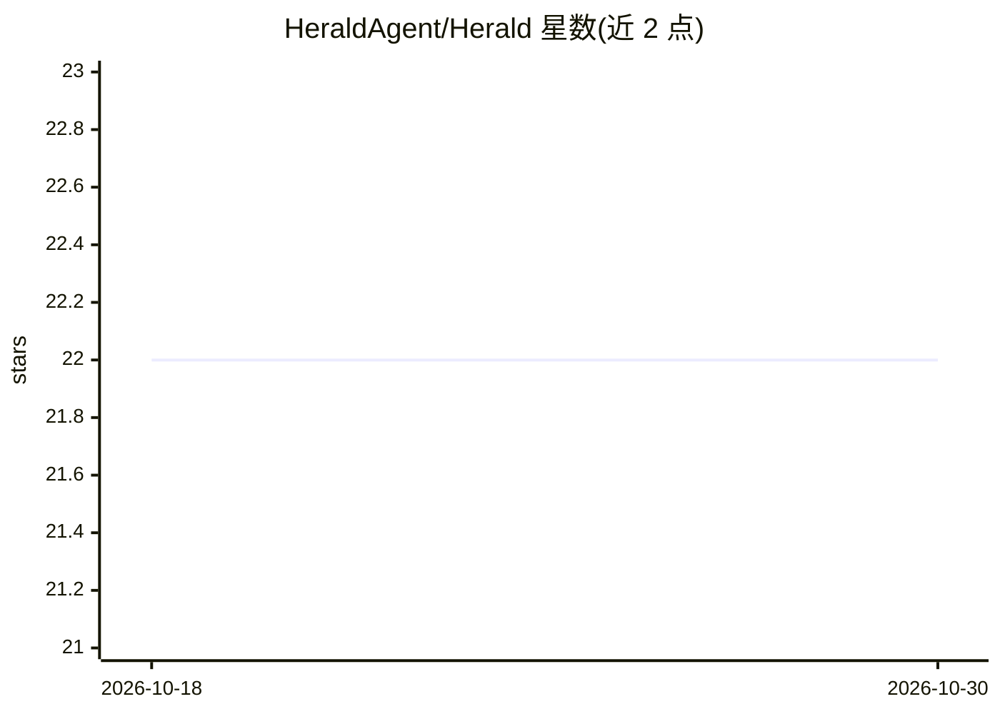

# HeraldAgent/Herald

⭐ 22 · TypeScript · MIT · 推送 2026-06-22 · [GitHub](https://github.com/HeraldAgent/Herald) · 个人维护

**把加密货币新闻标题转化为带时效的催化剂交易信号带**

面向加密货币交易操作者的新闻催化剂信号系统：从启用的信息源摄取标题，按事件类别分类并赋予预期半衰期（如 hack=45 分钟、listing=90 分钟），度量惊喜度与污染度（谣言措辞、匿名信源、社交回声），用排序公式 impact = categoryWeight + abs(rawSentiment)*2 - contaminationScore*3 计算，输出 ACTIONABLE/ACTIVE/CONTESTED/FADE/SUPPRESS 决策的催化剂信号带。提供看板、票据、衰减模型与污染过滤界面。通过 git clone + npm 安装本地运行。

## 筛选速览

| 维度 | 判定 | 备注 |
|---|---|---|
| AI 角色 | `ai-native` | 本体是模型或模型工具 |
| 许可风险 | `permissive` | MIT |
| 部署形态 | `library` | 以包/库形式分发 |
| 模型依赖 | — | README 未给出锁定关系 |
| 硬件要求 | — | 无带数字的原话,不猜 |
| 安装摩擦 | `low` | 无编译、无系统依赖或容器化 |
| 成熟度 | — | 结构信号不足 |

## 能力要点

- 按事件类别设定半衰期并跟踪信号衰减
- 污染分数过滤谣言循环与过度分发的新闻
- 排序启发式保持结构性催化剂高于炒作标题
- 输出 ACTIONABLE/ACTIVE/CONTESTED/FADE/SUPPRESS 五级决策

## 适用场景

- 交易时判断一条新闻是否还有可交易的剩余时效
- 过滤已被社交媒体充分分发的过期催化剂
- 按类别跟踪黑客攻击、上所、解锁等事件的影响窗口

## 场景标签

`金融量化` · 领域:学习与行业

## 证据(README 行号)

> L30: Live operating view for Herald: ranked catalyst tape across crypto news headlines, selected ticket with impact-buil
> L128: `impact = categoryWeight + abs(rawSentiment) * 2 - contaminationScore * 3`

## 星数曲线

2026-10-18 22 → 2026-10-30 22（+0）

---
*卡片 v1 · prompt 1.4 · 生成 2026-10-28 · 置信度 mid · 依据 README sha `eb90ed60e8d5` · [字段定义](../../DATASET.md)*
