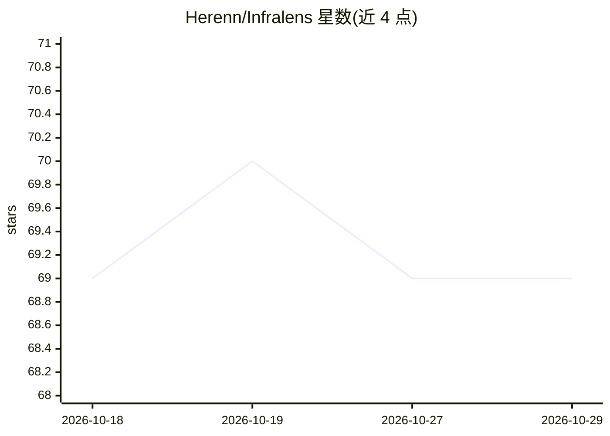

# Herenn/Infralens

⭐ 69 · Go · Apache-2.0 · 推送 2026-08-07 · [GitHub](https://github.com/Herenn/Infralens) · 个人维护

**eBPF 零侵入服务拓扑观测工具，附 AI 生成服务文档**

面向 Kubernetes 与普通 Linux 服务器的网络通信观测工具：每节点部署一个 eBPF agent，在内核层捕获全部 TCP 连接与 UDP 流（含 DNS/StatsD），无需改代码、SDK 或 sidecar；后端聚合事件、解析 K8s IP 到 Pod/Service 名、做服务指纹识别（PostgreSQL/Redis/Kafka 等）并持久化到 SQLite/PostgreSQL，前端以 WebSocket 增量更新实时渲染拓扑图。AI 部分为按需生成的服务文档：点击任一服务获得架构、安全与性能分析，支持 OpenAI/Anthropic/Gemini 或本地 Ollama/LM Studio。真实追踪需 Linux 内核 5.8+ 且带 BTF；提供无需 Linux 的 demo 模式。

## 筛选速览

| 维度 | 判定 | 备注 |
|---|---|---|
| AI 角色 | `ai-enhanced` | 去掉 AI 部分产品仍成立 |
| 许可风险 | `permissive` | Apache-2.0 |
| 部署形态 | `self-host` | docker 或自建部署 |
| 模型依赖 | local-ok | 支持本地模型 |
| 硬件要求 | — | 无带数字的原话,不猜 |
| 安装摩擦 | `low` | 无编译、无系统依赖或容器化 |
| 成熟度 | `idea` | |

## 能力要点

- 内核级 eBPF 探针捕获 TCP+UDP 流量，无需代码修改或 sidecar
- 服务指纹识别：从端口与进程名识别 PostgreSQL/Redis/Kafka 等数十种服务
- AI 生成服务文档，支持云端与本地（Ollama/LM Studio）模型
- Kubernetes DaemonSet 部署，自动 IP→Pod/Service 名解析

## 适用场景

- 接手陌生集群时快速搞清服务间实际调用关系
- 在不方便给每个服务埋点的环境下做网络拓扑观测
- 为未知服务生成架构与安全分析文档

## 场景标签

`AI 写作` · 领域:内容生成

## 证据(README 行号)

> L5: InfraLens uses eBPF to discover and visualize service-to-service communication in real time,
> L55: - 🧠 **AI-generated docs** — click any service and get architecture, security, and performance analysis (OpenAI, Ant
> L123: Click any service → **AI Docs** → get a generated explanation of what the service does, its tech stack, network be

## 星数曲线

2026-10-18 69 → 2026-10-29 69（+0）

---
*卡片 v1 · prompt 1.4 · 生成 2026-10-24 · 置信度 high · 依据 README sha `9cadbe86e459` · [字段定义](../../DATASET.md)*
