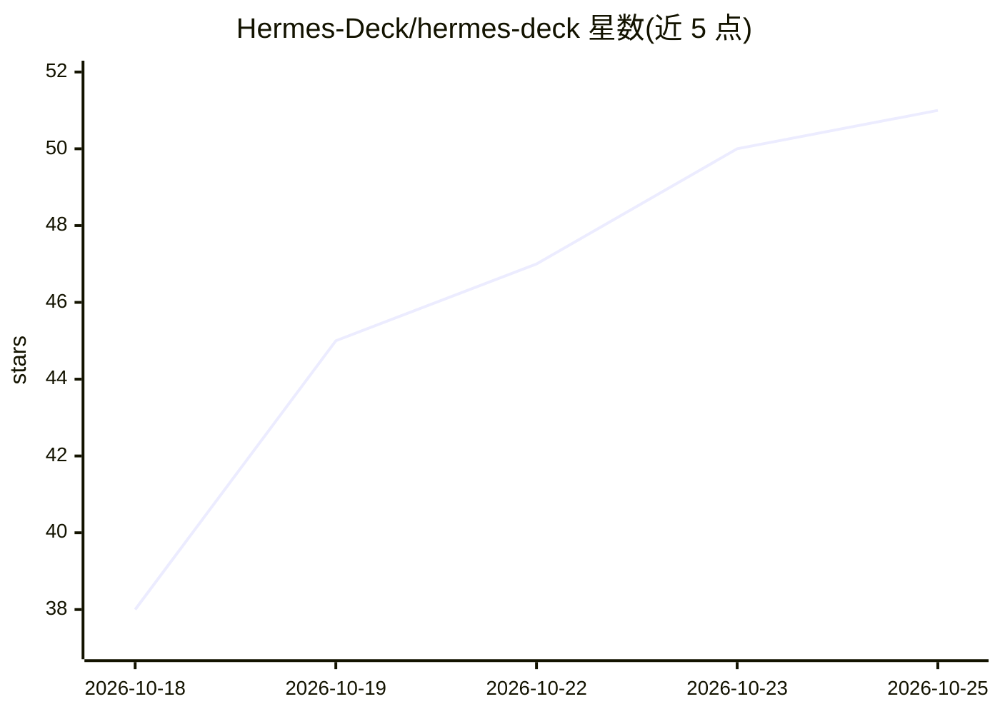

# Hermes-Deck/hermes-deck

⭐ 51 · JavaScript · 推送 2026-10-24 · [GitHub](https://github.com/Hermes-Deck/hermes-deck) · 组织维护

**管理 Hermes agent 的桌面客户端：聊天、监控与控制**

面向运行 Hermes Agent 用户的桌面应用（Windows x64、macOS Apple Silicon/Intel），通过插件经 SSH/WSL/本地连接 Hermes 实例。功能包括：浏览/继续各 profile 的会话、每 profile 独立 Bot 聊天、查看 agent 实时活动（思考、工具、子 agent）并可排队/转向/中断/接管、用量与配额监控（token、成本、Claude/Codex 限额）、可选 Telegram 模式。可选 relay 提供全域 agent 视图、agent 浏览器观看与单窗口桌面控制（默认关闭）。构建未签名，需校验 SHA256SUMS。

## 筛选速览

| 维度 | 判定 | 备注 |
|---|---|---|
| AI 角色 | `ai-ecosystem` | LLM/agent 周边工具 |
| 许可风险 | `none` | — |
| 部署形态 | `desktop` | 安装包/桌面程序 |
| 模型依赖 | — | README 未给出锁定关系 |
| 硬件要求 | — | 无带数字的原话,不猜 |
| 安装摩擦 | `low` | 无编译、无系统依赖或容器化 |
| 成熟度 | — | 结构信号不足 |

## 能力要点

- 经插件以 SSH/WSL/本地连接已运行的 Hermes 实例
- 实时查看 agent 活动（思考/工具/子 agent）并 steer/interrupt/stop/接管
- 用量与配额监控：token、成本、Claude/Codex 限额、网关健康
- 可选 relay 提供 agent 浏览器观看与单窗口桌面控制，默认关闭

## 适用场景

- 在一个窗口里与多个 Hermes agent 对话并监控其活动
- 统一处理各 agent 的命令审批与提问（Needs you 收件箱）
- 跟踪 token 成本与 Claude/Codex 订阅限额
- 让 agent 在指定窗口操作桌面并可随时接管

## 场景标签

`聊天机器人` `LLM 可观测性` · 领域:对话与助手

## 证据(README 行号)

> L5: Hermes Deck is a desktop app for Hermes Agent. It lets you chat with
> L42: Hermes + Deck plugin ←── SSH / WSL / local ──→ Deck app

## 星数曲线

2026-10-18 38 → 2026-10-25 51（+13）

---
*卡片 v1 · prompt 1.4 · 生成 2026-10-24 · 置信度 high · 依据 README sha `2ef8c1abba76` · [字段定义](../../DATASET.md)*
