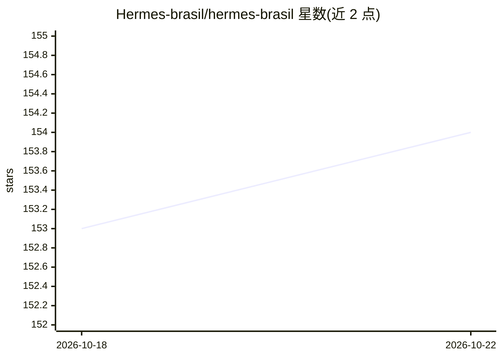

# Hermes-brasil/hermes-brasil

⭐ 154 · MIT · 推送 2026-10-19 · [GitHub](https://github.com/Hermes-brasil/hermes-brasil) · [官网](https://chat.whatsapp.com/DIDJlL9yQdlBY0fa4pABbe) · 组织维护

**Hermes Agent 巴西社区：葡语技能、指南与集成资源仓库**

面向 Hermes Agent（Nous Research 的开源 MIT AI 代理）巴西用户社区的资源仓库：收录葡萄牙语技能（SKILL.md 格式，兼容 agentskills.io 标准）、安装/生产部署指南，并预留 integrations 与 community 贡献区（尚未建立）。技能通过 hermes skills tap add 命令或复制到 ~/.hermes/skills/ 使用。社区通过 WhatsApp/Telegram/Discord/Discussions 运营，另有 Hermes Bible 社区指南站。贡献需遵循 SKILL.md 格式规范并通过本地测试流程。

## 筛选速览

| 维度 | 判定 | 备注 |
|---|---|---|
| AI 角色 | `ai-knowledge` | 知识聚合/清单类 |
| 许可风险 | `permissive` | MIT |
| 部署形态 | `None` |  |
| 模型依赖 | — | README 未给出锁定关系 |
| 硬件要求 | — | 无带数字的原话,不猜 |
| 安装摩擦 | `low` | 无编译、无系统依赖或容器化 |
| 成熟度 | — | 结构信号不足 |

## 能力要点

- 收录葡语 SKILL.md 格式技能，兼容 agentskills.io 标准
- 通过 hermes skills tap add 或手动复制目录安装技能
- 提供安装、VPS 生产部署、Cron、MCP 等系列葡语指南
- 以 fork + PR 流程接受技能、指南与集成贡献

## 适用场景

- 为 Hermes Agent 添加葡萄牙语技能
- 按葡语指南在 VPS 上部署运行 Hermes Agent
- 参与巴西 Hermes 社区贡献技能或集成

## 场景标签

`精选清单` · 领域:学习与行业

## 证据(README 行号)

> L5: Este repositório reúne skills, guias, integrações e recursos em **português** para a comunidade brasileira de Hermes
> L21: ├── skills/          → Skills em português (formato SKILL.md)

## 星数曲线

2026-10-18 153 → 2026-10-22 154（+1）

---
*卡片 v1 · prompt 1.4 · 生成 2026-10-22 · 置信度 high · 依据 README sha `7621a46977ac` · [字段定义](../../DATASET.md)*
