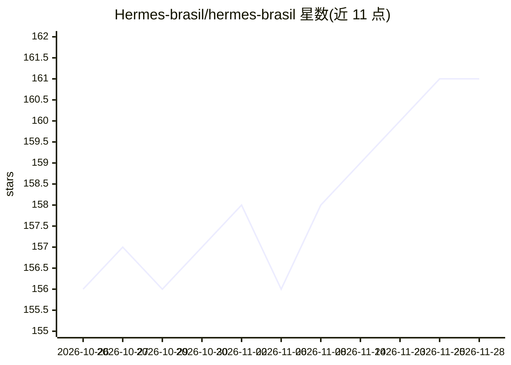

# Hermes-brasil/hermes-brasil

⭐ 161 · MIT · 推送 2026-11-16 · [GitHub](https://github.com/Hermes-brasil/hermes-brasil) · [官网](https://chat.whatsapp.com/DIDJlL9yQdlBY0fa4pABbe) · 个人维护

**面向巴西葡语社区的 Hermes Agent 技能与指南资源库**

Nous Research 开源 AI agent Hermes Agent 的巴西社区仓库，以葡萄牙语汇集 skills、指南与集成资源。仓库按 SKILL.md 格式（agentskills.io 标准）组织技能，可通过 Hermes 的 tap/install 命令或克隆后复制到 ~/.hermes/skills/ 使用；另提供安装、VPS 部署、Cron、MCP 服务器、n8n 与 WhatsApp 集成等 9 篇推荐指南，并汇总社区验证的 pt-BR 语言包等外部项目。skills 目录之外部分（community/）尚在规划中。

## 筛选速览

| 维度 | 判定 | 备注 |
|---|---|---|
| AI 角色 | `ai-knowledge` | 知识聚合/清单类 |
| 许可风险 | `permissive` | MIT |
| 部署形态 | `None` |  |
| 模型依赖 | — | README 未给出锁定关系 |
| 硬件要求 | — | 无带数字的原话,不猜 |
| 安装摩擦 | `low` | 无编译、无系统依赖或容器化 |
| 成熟度 | — | 结构信号不足 |

## 能力要点

- 以 SKILL.md 格式（agentskills.io 标准）收录葡萄牙语技能
- 9 篇推荐指南：安装、VPS 生产部署、Cron、MCP、n8n/WhatsApp 集成等
- 汇总社区验证的 pt-BR 语言包与桌面本地化项目
- 提供 WhatsApp/Telegram/Discord 社区频道与贡献流程

## 适用场景

- 为 Hermes Agent 安装葡萄牙语技能
- 在 VPS 上部署 Hermes Agent 并配置定时自动化
- 将 Hermes 接入 Telegram 或 WhatsApp 通道
- 为巴西葡语社区贡献技能或指南

## 场景标签

`工作流自动化` `精选清单` `教程课程` · 领域:效率与自动化

## 证据(README 行号)

> L5: Este repositório reúne skills, guias, integrações e recursos em **português** para a comunidade brasileira de Hermes
> L21: ├── skills/          → Skills em português (formato SKILL.md)
> L44: 1. Instalação básica

## 星数曲线

2026-10-26 156 → 2026-11-28 161（+5）

---
*卡片 v1 · prompt 1.4 · 生成 2026-11-27 · 置信度 high · 依据 README sha `63685b246d43` · [字段定义](../../DATASET.md)*
