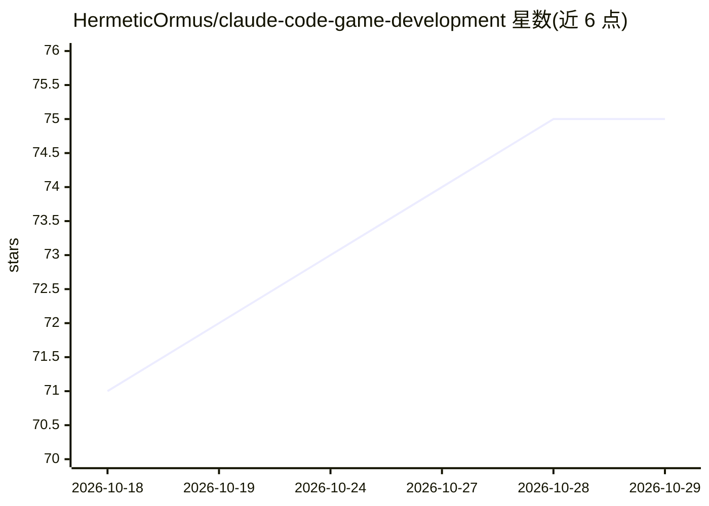

# HermeticOrmus/claude-code-game-development

⭐ 75 · Python · MIT · 推送 2026-10-04 · [GitHub](https://github.com/HermeticOrmus/claude-code-game-development) · [官网](https://ormus.solutions) · 个人维护

**面向 Claude Code 的游戏开发插件市场与教程仓库（87 插件+80 章手册）**

为 Claude Code 提供可安装插件的游戏开发资源仓库：87 个插件中 22 个面向游戏（Godot、Unity、Unreal、渲染、AI、netcode、playtesting、shipping 等），另含 65 个通用开发插件，来自 LibreGameDev 的 20 个游戏插件与可选 hooks（会话启动引擎检测、密钥操作确认）。配套 80 章、约 18 万字的游戏开发文档与 meta-prompting 工具集。通过 Claude Code 的 /plugin 命令或 setup.sh 安装，setup.sh 需要 claude CLI 与 jq；插件也可在 Grok Build 中加载，其中 libre-gamedev-hooks 未在真实 Grok 会话中验证。

## 筛选速览

| 维度 | 判定 | 备注 |
|---|---|---|
| AI 角色 | `ai-ecosystem` | LLM/agent 周边工具 |
| 许可风险 | `permissive` | MIT |
| 部署形态 | `None` |  |
| 模型依赖 | locked-api |  |
| 硬件要求 | — | 无带数字的原话,不猜 |
| 安装摩擦 | `low` | 无编译、无系统依赖或容器化 |
| 成熟度 | — | 结构信号不足 |

## 能力要点

- 87 个可安装插件，其中 22 个为游戏开发插件（Godot/Unity/Unreal/netcode 等）
- 80 章约 18 万字游戏开发文档与 meta-prompting 框架
- 支持 Claude Code 插件市场命令与 setup.sh 批量安装
- 插件兼容 Grok Build 加载

## 适用场景

- 在 Claude Code 中获得 Godot/Unity/Unreal 等游戏开发插件能力
- 按 80 章手册学习用自然语言提示开发完整游戏
- 从零开始用一个提示在 10 分钟内构建 Pong 等示例游戏

## 场景标签

`教程课程` `提示工程` · 领域:Agent 开发

## 证据(README 行号)

> L67: 1. **Installable Claude Code Plugins**: 87 plugins, 22 of them for game development (Godot, Unity, Unreal, renderin
> L169: /plugin marketplace add HermeticOrmus/claude-code-game-development
> L186: ### Install in Grok Build

## 星数曲线

2026-10-18 71 → 2026-10-29 75（+4）

---
*卡片 v1 · prompt 1.4 · 生成 2026-10-24 · 置信度 high · 依据 README sha `f83ae4766c3c` · [字段定义](../../DATASET.md)*
