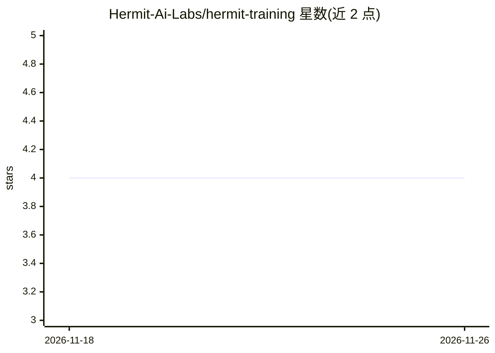

# Hermit-Ai-Labs/hermit-training

⭐ 4 · Python · NOASSERTION · 推送 2026-11-12 · [GitHub](https://github.com/Hermit-Ai-Labs/hermit-training) · [官网](https://hermit.my) · 组织维护

**Hermit 钱包端上模型的训练数据、生成器与评测配方**

记录 Hermit 1.3（4B）与 Hermit 1.3 Lite（1.7B）两个 iPhone/Mac 钱包端上助手模型的完整制作过程：仓库包含 21,361 条训练对话及其生成程序、30 个工具的 schema 与系统提示、36 个评测套件与打分器、LoRA 训练脚本和 MLX 量化脚本。数据由基于模拟钱包世界的生成器产生，地址随机、不使用真实密钥。生成器可本地复现（无需网络与 GPU），部分装配步骤因缺少旧版输入而不可完整重跑。

## 筛选速览

| 维度 | 判定 | 备注 |
|---|---|---|
| AI 角色 | `ai-knowledge` | 知识聚合/清单类 |
| 许可风险 | `none` | NOASSERTION |
| 部署形态 | `None` |  |
| 模型依赖 | — | README 未给出锁定关系 |
| 硬件要求 | — | 无带数字的原话,不猜 |
| 安装摩擦 | `low` | 无编译、无系统依赖或容器化 |
| 成熟度 | — | 结构信号不足 |

## 能力要点

- 包含训练数据、生成程序、评测套件与打分器的完整训练材料
- 数据由模拟钱包世界的生成器确定性产生，固定种子可复现
- 基座为 Qwen3，采用 LoRA 微调并导出 MLX 5-bit/6-bit 端上格式
- 评测含 3,700 条 held-out 项，原始转录随仓库附上可复核

## 适用场景

- 研究面向工具调用的合成训练数据构造方法
- 复用其评测套件与打分器测试自有模型
- 参考端上模型（MLX 量化）的训练与导出流程

## 场景标签

`模型评测` `微调` `模型量化` · 领域:评测与运维

## 证据(README 行号)

> L11: This repo shows how the two on-device models behind the Hermit wallet were made: **Hermit 1.3** (4B) and **Hermit 1
> L37: |Folder|What it holds|
> L78: - The **gen4 and gen3 pools** are deterministic. A fixed seed gives the same rows. I checked this on `safety_mixed`

## 星数曲线

2026-11-18 4 → 2026-11-26 4（+0）

---
*卡片 v1 · prompt 1.4 · 生成 2026-11-21 · 置信度 high · 依据 README sha `f3d1802f8a02` · [字段定义](../../DATASET.md)*
