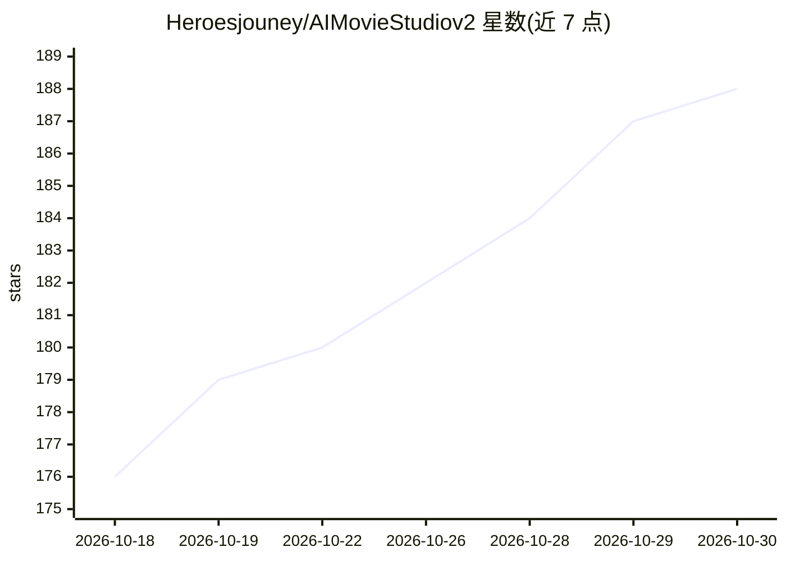

# Heroesjouney/AIMovieStudiov2

⭐ 188 · TypeScript · AGPL-3.0 · 推送 2026-09-29 · [GitHub](https://github.com/Heroesjouney/AIMovieStudiov2) · 个人维护

**面向电影制作者的模型无关 AI 电影制作工作台**

浏览器端 AI 电影制作工作站：在 3D 舞台上摆放虚拟相机取景，生成 AI 分镜图并转为视频，添加对白与音频后导出时间线 XML 供 Premiere/DaVinci 等剪辑。通过 "Driver System" 适配器在本地 ComfyUI 与云 API（Fal/Replicate）间切换，支持多参考图保持角色与场景连续性、LoRA 管理、Fountain/FDX 剧本导入，以及实验性的 3D 相机预演与长镜头模式。面向不要求开发背景的创作者，但本地部署需 Python 3.10+、Node.js 18+、ComfyUI 与 CUDA GPU（也可纯云端）。项目自述处于活跃开发期，功能可能变动。

## 筛选速览

| 维度 | 判定 | 备注 |
|---|---|---|
| AI 角色 | `ai-native` | 本体是模型或模型工具 |
| 许可风险 | `dual` | AGPL-3.0 |
| 部署形态 | `self-host` | docker 或自建部署 |
| 模型依赖 | — | README 未给出锁定关系 |
| 硬件要求 | — | 无带数字的原话,不猜 |
| 安装摩擦 | `low` | 无编译、无系统依赖或容器化 |
| 成熟度 | `idea` | |

## 能力要点

- Driver System 在本地 ComfyUI 与云 API（Fal/Replicate）间切换而 UI 不变
- 3D 分镜：虚拟相机取景、180° 轴线警告、实验性 3D 相机预演渲染 MP4
- 多参考图生成保持角色/场景连续性，UI 内管理 LoRA 与自定义 ComfyUI 工作流
- Fountain/FDX 剧本导入并自动推断时段、情绪与光照

## 适用场景

- 独立创作者在 3D 舞台规划镜头并生成 AI 分镜与视频
- 用本地 ComfyUI 或云 API 生成保持角色一致性的连续画面
- 将分镜组装为时间线并导出 XML 到 Premiere/DaVinci 剪辑

## 场景标签

`图像生成` `视频生成` · 领域:内容生成

## 证据(README 行号)

> L37: AI Movie Studio 2 is a browser-based, **model-agnostic** AI filmmaking workstation. You design scenes, place camera
> L64: - **🔌 Works with Any AI Model** - The "Driver System" lets you swap between local ComfyUI and cloud providers (Fal,
> L69: - **🎞️ Timeline & Export** - Assemble shots into a timeline, add audio, and export to XML for editing in Premiere, 

## 星数曲线

2026-10-18 176 → 2026-10-30 188（+12）

---
*卡片 v1 · prompt 1.4 · 生成 2026-10-22 · 置信度 high · 依据 README sha `7e883ef4fcd1` · [字段定义](../../DATASET.md)*
