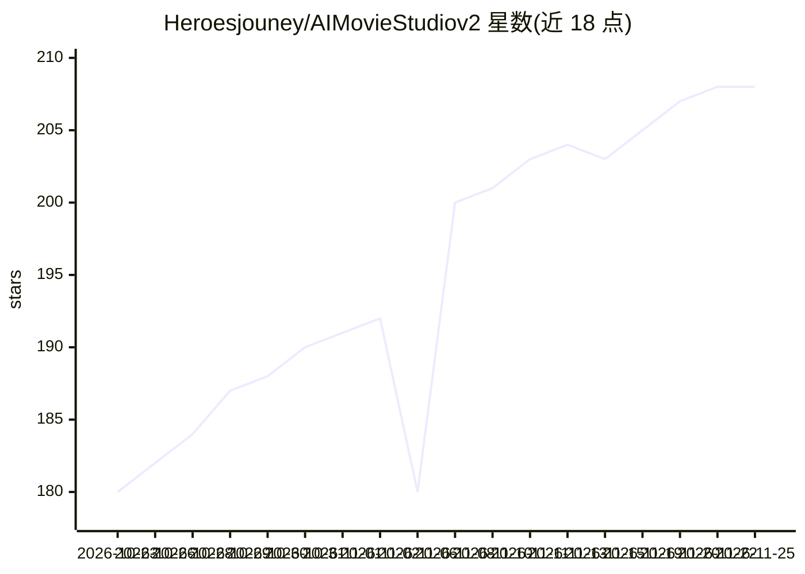

# Heroesjouney/AIMovieStudiov2

⭐ 208 · TypeScript · AGPL-3.0 · 推送 2026-11-16 · [GitHub](https://github.com/Heroesjouney/AIMovieStudiov2) · 个人维护

**面向独立创作者的模型无关 AI 电影制作工作台**

浏览器端的 AI 电影制作工作站：在 3D 空间中布置虚拟相机取景、用 AI 生成分镜帧并转为视频、加入对白与音频，最终导出时间线 XML（可导入 Premiere/DaVinci）。本地数据存储，无云端依赖。通过适配器模式接入本地 ComfyUI 或 Fal/Replicate 云 API，可在不改动 UI 的情况下切换生成引擎；支持 LoRA、自定义工作流上传与多参考图一致性控制。项目标注为进行中，部分管线为实验性，版本间可能出现破坏性变更。

## 筛选速览

| 维度 | 判定 | 备注 |
|---|---|---|
| AI 角色 | `ai-native` | 本体是模型或模型工具 |
| 许可风险 | `dual` | AGPL-3.0 |
| 部署形态 | `self-host` | docker 或自建部署 |
| 模型依赖 | — | README 未给出锁定关系 |
| 硬件要求 | — | 无带数字的原话,不猜 |
| 安装摩擦 | `low` | 无编译、无系统依赖或容器化 |
| 成熟度 | `idea` | |

## 能力要点

- 3D 分镜：虚拟相机取景、FOV 锥、180° 轴线违规警告
- Driver 系统在本地 ComfyUI 与 Fal/Replicate 云 API 间切换
- 多参考图注入的连续性系统（角色/场景一致性锁定）
- 剧本导入（Fountain/.fdx）与时间线 XML 导出

## 适用场景

- 独立创作者在开拍前生成分镜与概念样片
- 为提案搭建可与制片方案并列的视觉 pitch 包
- 用剧本文件批量拆解场景并生成分镜板
- 在 LED 虚拟制片流程前做 3D 相机预演

## 场景标签

`图像生成` `视频生成` · 领域:内容生成

## 证据(README 行号)

> L37: AI Movie Studio 2 is a browser-based, **model-agnostic** AI filmmaking workstation. You design scenes, place camera
> L64: - **🔌 Works with Any AI Model** - The "Driver System" lets you swap between local ComfyUI and cloud providers (Fal,

## 星数曲线

2026-10-23 180 → 2026-11-25 208（+28）

---
*卡片 v1 · prompt 1.4 · 生成 2026-11-25 · 置信度 high · 依据 README sha `63e6afca70e5` · [字段定义](../../DATASET.md)*
