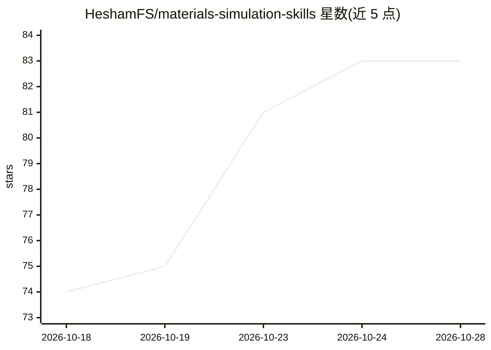

# HeshamFS/materials-simulation-skills

⭐ 83 · Python · Apache-2.0 · 推送 2026-10-21 · [GitHub](https://github.com/HeshamFS/materials-simulation-skills) · 个人维护

**给 AI 编程代理的 24 个计算材料学/数值模拟技能包**

遵循开放 Agent Skills 标准的技能合集：将数值稳定性、时间步进、网格收敛、求解器诊断、SLURM 部署、V&V、FAIR 数据与 CMSO 本体等领域知识打包为可被 Claude Code、Codex、Cursor、GitHub Copilot 等 20+ 工具自动发现加载的技能（指令+脚本）。提供 npx/gh skill 生态安装器与 mss CLI 捆绑安装，CI 中以确定性 eval 覆盖全部用例（115 用例/725 断言）；明确声明 agent 提升幅度未验证。

## 筛选速览

| 维度 | 判定 | 备注 |
|---|---|---|
| AI 角色 | `ai-knowledge` | 知识聚合/清单类 |
| 许可风险 | `permissive` | Apache-2.0 |
| 部署形态 | `library` | 以包/库形式分发 |
| 模型依赖 | — | README 未给出锁定关系 |
| 硬件要求 | — | 无带数字的原话,不猜 |
| 安装摩擦 | `low` | 无编译、无系统依赖或容器化 |
| 成熟度 | — | 结构信号不足 |

## 能力要点

- 24 个技能覆盖 8 类：核心数值方法、模拟工作流、HPC 部署、V&V、FAIR 数据、本体等
- 兼容 20+ agent 工具，生态安装器开箱即用，另带 mss CLI 按捆绑包安装
- CI 强制 100% 确定性 eval 覆盖（115 用例、725 断言），规则引用 ASME V&V20 等标准
- README 显式声明 live-agent 提升未验证、确定性通过不等于物理模拟正确

## 适用场景

- 让 AI 编程代理自动检查 CFL 稳定性、网格收敛等数值问题
- 生成 SLURM 脚本与诊断 HPC 运行时故障
- 为材料模拟项目做验证与确认（V&V）和 FAIR 数据打包

## 场景标签

`Agent 框架` · 领域:Agent 开发

## 证据(README 行号)

> L12: > **New to Agent Skills?** A "skill" is a portable folder of instructions + small scripts that an AI coding agent *
> L27: No prompt engineering, no copy-pasting formulas. **24 skills** span numerical methods, simulation workflows, HPC de
> L50: npx skills add HeshamFS/materials-simulation-skills          # any agent → ~/.agents/skills/

## 星数曲线

2026-10-18 74 → 2026-10-28 83（+9）

---
*卡片 v1 · prompt 1.4 · 生成 2026-10-24 · 置信度 high · 依据 README sha `3dec4b9df65f` · [字段定义](../../DATASET.md)*
