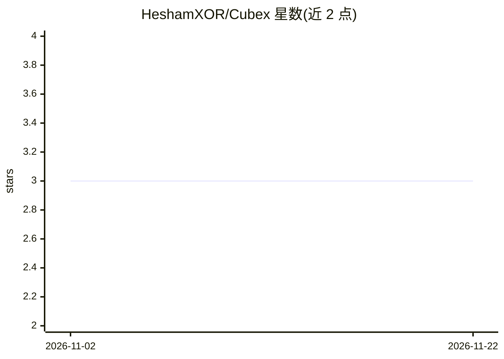

# HeshamXOR/Cubex

⭐ 3 · TypeScript · MIT · 推送 2026-11-07 · [GitHub](https://github.com/HeshamXOR/Cubex) · 个人维护

**连接任意模型的桌面编码 Agent，逐块审查代码改动**

Cubex 是 Electron 桌面应用，用于在本地代码库上运行编码 Agent：用户自带 API key 选择云端模型，或连接本机 Ollama/LM Studio/llama.cpp 运行时。Agent 读取项目、编辑文件、运行命令与搜索网页，每项改动以 diff 呈现，可按文件或按 hunk 保留、撤销或评论。提供 17 个 provider 预设、4 种权限模式、计划先行流程、上下文与花费计量、git worktree 多模型竞跑，无账号、无遥测，对话存本地数据库。官方构建仅测试 Windows 10/11 x64。

## 筛选速览

| 维度 | 判定 | 备注 |
|---|---|---|
| AI 角色 | `ai-native` | 本体是模型或模型工具 |
| 许可风险 | `permissive` | MIT |
| 部署形态 | `desktop` | 安装包/桌面程序 |
| 模型依赖 | local-ok | 支持本地模型 |
| 硬件要求 | — | 无带数字的原话,不猜 |
| 安装摩擦 | `low` | 无编译、无系统依赖或容器化 |
| 成熟度 | — | 结构信号不足 |

## 能力要点

- 17 个 provider 预设，Anthropic/OpenAI/Gemini/Ollama 各有原生适配器
- 所有改动以 diff 呈现，支持按 hunk 保留/撤销/评论后回传
- 4 种权限模式与每项目规则、hooks、计划审批
- git worktree 隔离任务，最多 4 个模型竞跑同一任务并对比 diff

## 适用场景

- 用自有 API key 在本地项目上运行编码 Agent 并逐块审查改动
- 通过 Ollama 等本机运行时完全离线使用编码 Agent
- 让多个模型对同一任务给出方案并对比后采纳
- 按会话/每日设置花费上限并监控上下文占用

## 场景标签

`编码 Agent` · 领域:编码与开发

## 证据(README 行号)

> L5: Connect a cloud provider or a model running on your own machine, point Cubex at a project,
> L20: Cubex is a desktop app for working with a coding agent on your own code. You choose the model, either
> L23: diff that you can keep, undo or comment on, one hunk at a time, before anything is committed.

## 星数曲线

2026-11-02 3 → 2026-11-22 3（+0）

---
*卡片 v1 · prompt 1.4 · 生成 2026-11-22 · 置信度 low · 依据 README sha `4791e9bc7897` · [字段定义](../../DATASET.md)*
