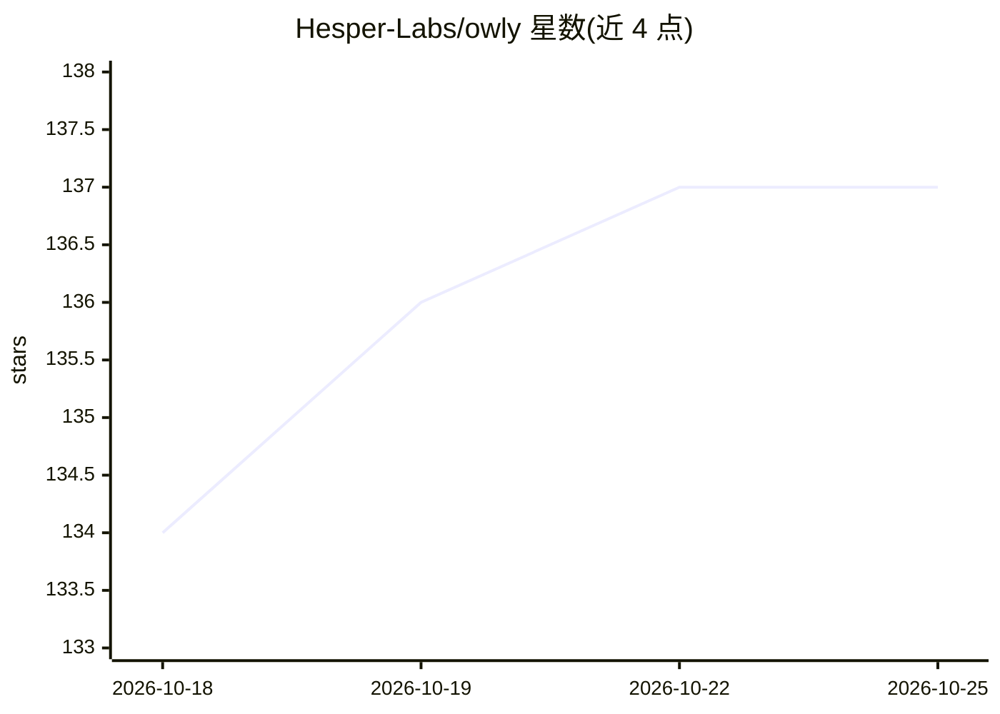

# Hesper-Labs/owly

⭐ 138 · TypeScript · MIT · 推送 2026-04-14 · [GitHub](https://github.com/Hesper-Labs/owly) · [官网](https://github.com/hsperus/owly/wiki) · 组织维护

**自托管 AI 客服 agent：统一 WhatsApp/邮件/电话渠道**

面向小企业与个人的自托管 AI 客服系统：接入 WhatsApp、Email（IMAP/SMTP）与 Twilio 电话（Whisper STT + ElevenLabs TTS），基于 OpenAI GPT（可扩展 Claude/Ollama）结合知识库自动回复，AI 可在对话中建工单、路由部门、发内部邮件、触发 webhook。内置跨渠道统一客户档案、自动化规则、SLA、工单与分析面板，提供 REST API 与 OpenAPI 3.0 文档。需 Node.js 20+ 与 PostgreSQL 16+，支持 npm、Docker Compose 与 Kubernetes Helm 部署，无月费仅付 AI API 用量。

## 筛选速览

| 维度 | 判定 | 备注 |
|---|---|---|
| AI 角色 | `ai-native` | 本体是模型或模型工具 |
| 许可风险 | `permissive` | MIT |
| 部署形态 | `self-host` | docker 或自建部署 |
| 模型依赖 | local-ok | 支持本地模型 |
| 硬件要求 | — | 无带数字的原话,不猜 |
| 安装摩擦 | `low` | 无编译、无系统依赖或容器化 |
| 成熟度 | — | 结构信号不足 |

## 能力要点

- WhatsApp/Email/Phone 三渠道统一收件箱与跨渠道客户身份归并
- AI 对话中可建工单、路由部门、查历史、触发 webhook、安排跟进
- 知识库、自动化规则、SLA、工单与分析面板
- OpenAPI 3.0 REST API 与 Docker Compose/Kubernetes Helm 部署

## 适用场景

- 小企业自建 AI 客服，替代按月订阅的 SaaS 客服产品
- 在自有服务器上托管客户数据并统一管理多渠道咨询
- 通过 REST API 将客服会话与工单接入外部系统

## 场景标签

`聊天机器人` · 领域:对话与助手

## 证据(README 行号)

> L27: Owly is a **self-hosted AI customer support agent** that small businesses and individuals can run on their own mach
> L62: Owly uses OpenAI GPT (extensible to Claude, Ollama) with your knowledge base to provide accurate, on-brand response

## 星数曲线

2026-10-18 134 → 2026-10-25 137（+3）

---
*卡片 v1 · prompt 1.4 · 生成 2026-10-22 · 置信度 high · 依据 README sha `3bffcf24ce12` · [字段定义](../../DATASET.md)*
