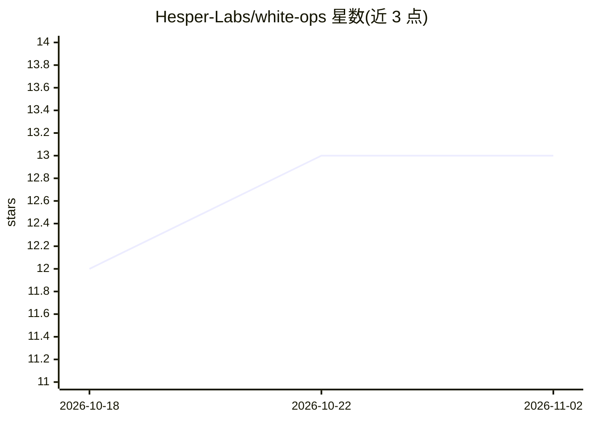

# Hesper-Labs/white-ops

⭐ 13 · Python · Apache-2.0 · 推送 2026-04-09 · [GitHub](https://github.com/Hesper-Labs/white-ops) · [官网](https://github.com/hsperus/white-ops) · 组织维护

**开源企业 AI 员工平台：多机部署代理执行办公与研发任务**

面向企业的 AI 代理工作平台：在多台 PC 上部署代理，处理邮件、文档、网页调研、数据分析、代码审查、DevOps、云运维及 CRM/发票等办公任务。提供 83+ 工具、37 页管理面板、对话界面、实时执行终端、可视化工作流构建器、4 级自主安全分级与逐代理成本跟踪。多 LLM 支持（Claude/GPT/Gemini/Ollama 本地）经统一接口接入，由 LiteLLM 驱动。技术栈为 React SPA + FastAPI + PostgreSQL/Redis/MinIO，以 12 个 Docker 服务或 Helm/Kubernetes 方式部署，最低要求 4 核 8GB 内存。

## 筛选速览

| 维度 | 判定 | 备注 |
|---|---|---|
| AI 角色 | `ai-ecosystem` | LLM/agent 周边工具 |
| 许可风险 | `permissive` | Apache-2.0 |
| 部署形态 | `self-host` | docker 或自建部署 |
| 模型依赖 | local-ok | 支持本地模型 |
| 硬件要求 | — | 无带数字的原话,不猜 |
| 安装摩擦 | `low` | 无编译、无系统依赖或容器化 |
| 成熟度 | — | 结构信号不足 |

## 能力要点

- 83+ 工具覆盖办公、通信、DevOps、云与业务类别
- 多 PC worker 分布式部署，单面板管理
- 多 LLM 统一接口：Claude/GPT/Gemini/Ollama（本地）
- 4 级自主控制、审批流、RBAC 与 AES-256 密钥库等安全机制

## 适用场景

- 在企业内多台机器部署 AI 代理自动化办公与运维任务
- 通过管理面板集中管理代理、工作流与成本
- 以代码审批流约束代理生成的代码改动

## 场景标签

`多智能体` `工作流自动化` · 领域:Agent 开发

## 证据(README 行号)

> L11: Enterprise AI workforce platform. Deploy AI agents on multiple PCs that handle professional tasks: email, documents
> L23: |**Multi-LLM**|Claude, GPT, Gemini, Ollama (local) via unified interface|
> L43: React SPA (37 pages) --> FastAPI Server (29 API modules) --> PostgreSQL + Redis + MinIO

## 星数曲线

2026-10-18 12 → 2026-11-02 13（+1）

---
*卡片 v1 · prompt 1.4 · 生成 2026-10-31 · 置信度 high · 依据 README sha `a10f86104382` · [字段定义](../../DATASET.md)*
