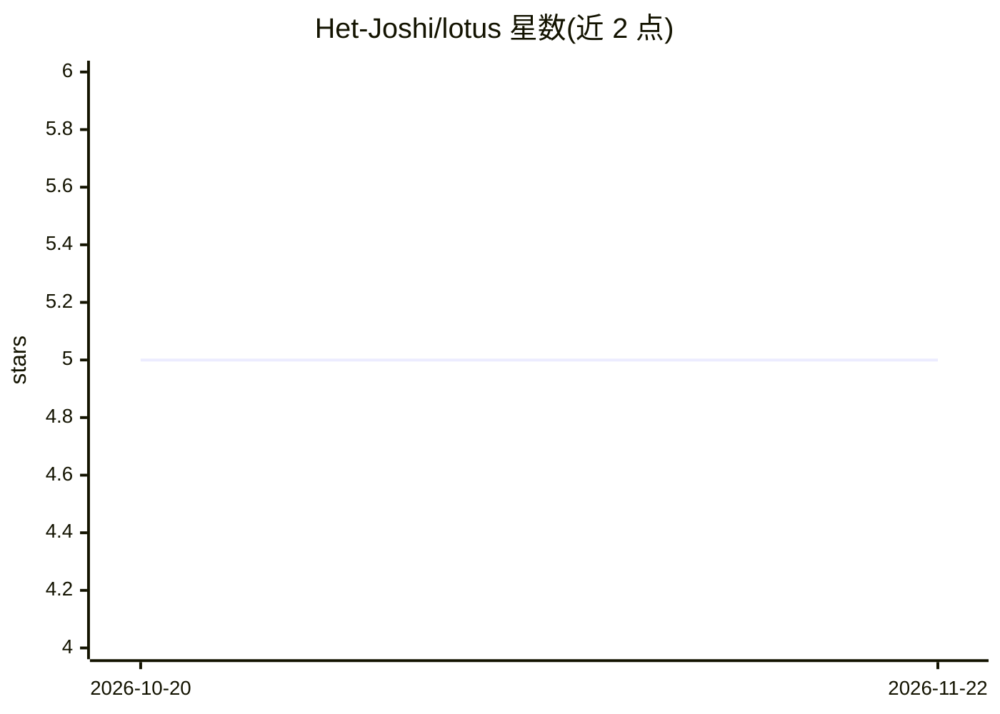

# Het-Joshi/lotus

⭐ — · [GitHub]() · 个人维护

**面向 Ollama 小模型的本地终端 agent 工具**

lotus 是一个纯 Python 的终端 agent，驱动本机 Ollama 模型执行文件、shell、网页与浏览器操作。针对小模型做了适配：按需加载工具、容错解析不规范的工具调用、循环检测与上下文压缩。操作前需确认（shell/写入/购买类按钮），页面加载前比对恶意软件与钓鱼名单，支持 Tor 私密浏览、子 agent 并行、定时 recipes、MCP 服务器与 Python 插件扩展。需本机已安装 Ollama 并拉取模型。

## 筛选速览

| 维度 | 判定 | 备注 |
|---|---|---|
| AI 角色 | `ai-ecosystem` | LLM/agent 周边工具 |
| 许可风险 | `permissive` | — |
| 部署形态 | `desktop` | 安装包/桌面程序 |
| 模型依赖 | local-ok | 支持本地模型 |
| 硬件要求 | — | 无带数字的原话,不猜 |
| 安装摩擦 | `low` | 无编译、无系统依赖或容器化 |
| 成熟度 | — | 结构信号不足 |

## 能力要点

- 纯 Python 无依赖，本地运行，无 API key 与遥测
- 针对小模型的工具路由、容错工具调用与循环切断
- 隐身 Firefox 浏览器控制与钓鱼/恶意软件名单检查
- MCP 服务器、Python 插件与定时 recipes 扩展

## 适用场景

- 让本地小模型代替我完成文件与 shell 任务
- 用自然语言操控浏览器完成搜索和下单类操作
- 通过 Tor 私密浏览并规避钓鱼页面
- 用管道方式把 lotus 接入脚本与 SSH 工作流

## 场景标签

`AI 助手` `浏览器自动化` · 领域:效率与自动化

## 证据(README 行号)

> L3: A terminal agent for Ollama that actually works with small local models.
> L14: Files, shell, web and a real browser, driven by a small model on your own machine. Pure Python, no dependencies, no

## 星数曲线

2026-10-20 5 → 2026-11-22 5（+0）

---
*卡片 v1 · prompt 1.4 · 生成 2026-11-21 · 置信度 high · 依据 README sha `575f24d639b0` · [字段定义](../../DATASET.md)*
