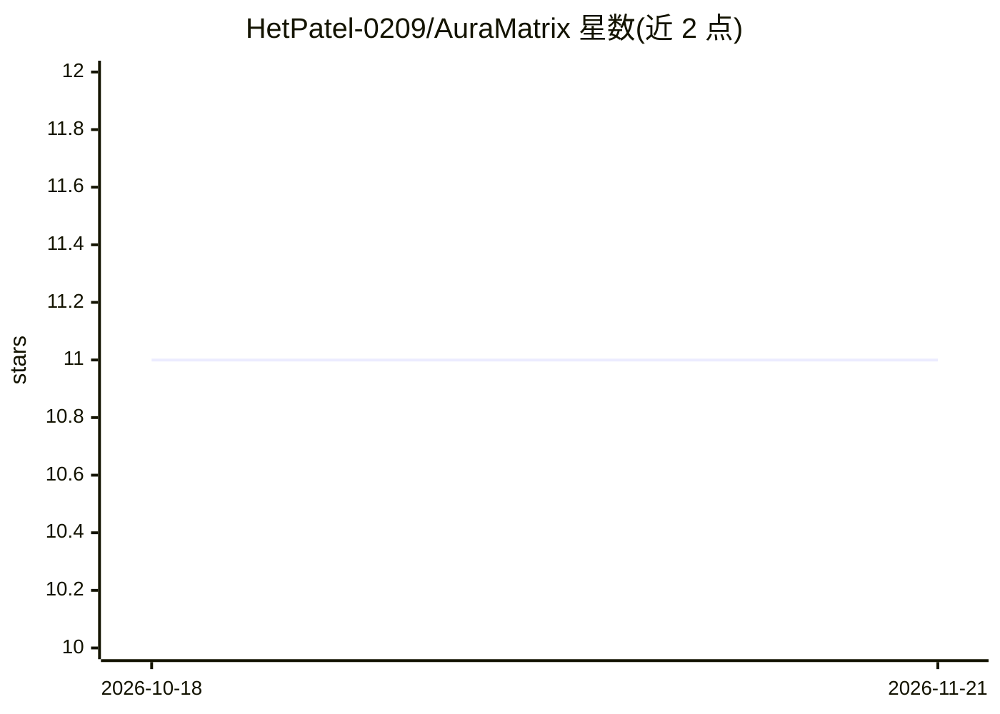

# HetPatel-0209/AuraMatrix

⭐ 11 · JavaScript · 推送 2025-12-22 · [GitHub](https://github.com/HetPatel-0209/AuraMatrix) · [官网](https://aura-matrix.vercel.app) · 组织维护

**用 LLM 分析人格特质的 Web 应用**

AuraMatrix 是一个基于网页的人格特质分析工具，用户输入个人细节或测试数据后，由 LLM 生成人格分析结果。项目为 Gyanotsav-2025 活动而建，作者称其为首个生产就绪项目。技术栈为 JavaScript/HTML/CSS，配合 Gradio 主题标签与 NIM 图像生成服务；通过 git clone、npm install、npm start 在本地 3000 端口运行，并提供在线演示链接。由 4 名个人开发者共同维护。

## 筛选速览

| 维度 | 判定 | 备注 |
|---|---|---|
| AI 角色 | `ai-native` | 本体是模型或模型工具 |
| 许可风险 | `none` | — |
| 部署形态 | `library` | 以包/库形式分发 |
| 模型依赖 | locked-api |  |
| 硬件要求 | — | 无带数字的原话,不猜 |
| 安装摩擦 | `low` | 无编译、无系统依赖或容器化 |
| 成熟度 | `idea` | |

## 能力要点

- LLM 驱动的人格特质分析，Groq 作为分析服务
- NIM 支持图像生成功能
- 响应式 UI，适配多设备
- 提供在线演示与本地运行步骤

## 适用场景

- 输入个人数据让 AI 生成人格分析结果
- 向工程师演示 LLM 的个人用途
- 在活动中展示 AI 人格分析玩法

## 场景标签

`数据分析` · 领域:效率与自动化

## 证据(README 行号)

> L13: AuraMatrix is a web-based tool that analyzes personality traits using AI. It started as a fun experiment for **Gyan
> L19: - 🤖 **AI-Powered Analysis** - Let a Large Language Model analyze *you*!
> L29: - **LLM Services Groq** - The brains behind the analysis.

## 星数曲线

2026-10-18 11 → 2026-11-21 11（+0）

---
*卡片 v1 · prompt 1.4 · 生成 2026-11-19 · 置信度 high · 依据 README sha `2d7f54f6e176` · [字段定义](../../DATASET.md)*
