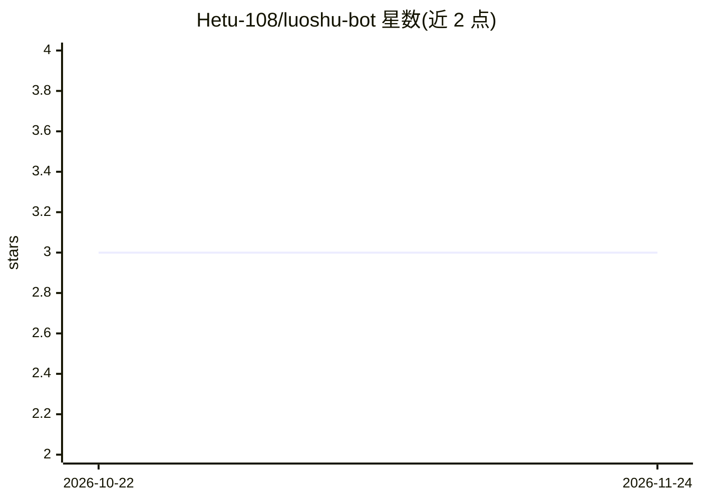

# Hetu-108/luoshu-bot

⭐ 3 · Python · 推送 2026-11-19 · [GitHub](https://github.com/Hetu-108/luoshu-bot) · 个人维护 · 中文 README

**QQ 群聊机器人：本地大模型驱动的人格化聊天**

基于 NoneBot2 + OneBot v11 的 QQ 群机器人，AI 对话由本地 Ollama 大模型驱动，聊天数据不出本机、不依赖付费接口。功能包括带上下文记忆的群聊对话、用户记忆（称呼/备注/互动次数）、抽签运势塔罗等娱乐命令、关键词自动回复、按群独立的功能开关、四级权限管理与群统计。需自备 OneBot v11 登录端（LLOneBot/NapCat 等）登录 QQ。提供 Windows 批处理脚本与 Linux 安装/systemd 脚本。

## 筛选速览

| 维度 | 判定 | 备注 |
|---|---|---|
| AI 角色 | `ai-native` | 本体是模型或模型工具 |
| 许可风险 | `none` | — |
| 部署形态 | `desktop` | 安装包/桌面程序 |
| 模型依赖 | local-ok | 支持本地模型 |
| 硬件要求 | — | 无带数字的原话,不猜 |
| 安装摩擦 | `low` | 无编译、无系统依赖或容器化 |
| 成熟度 | — | 结构信号不足 |

## 能力要点

- 本地 Ollama 大模型驱动，聊天数据不出本机
- 用户记忆：记住群名片、称呼与备注，按人互动
- 多群隔离的功能开关与四级权限体系
- 敏感词库过滤 AI 输入输出，识别变形写法

## 适用场景

- 在 QQ 群里部署一个有固定人设的本地 AI 聊天机器人
- 不想把群聊数据发给云端模型接口的场景
- 给群提供运势抽签等娱乐功能与关键词自动回复

## 场景标签

`聊天机器人` · 领域:对话与助手

## 证据(README 行号)

> L5: 基于 NoneBot2 + OneBot v11 ｜ 本地大模型驱动 ｜ 数据不出本机
> L223: ### 💬 AI 对话（所有人）
> L262: - **本地大模型**：AI 对话走 Ollama，不依赖付费接口，**聊天数据不出本机**

## 星数曲线

2026-10-22 3 → 2026-11-24 3（+0）

---
*卡片 v1 · prompt 1.4 · 生成 2026-11-22 · 置信度 high · 依据 README sha `7a16d35d7104` · [字段定义](../../DATASET.md)*
