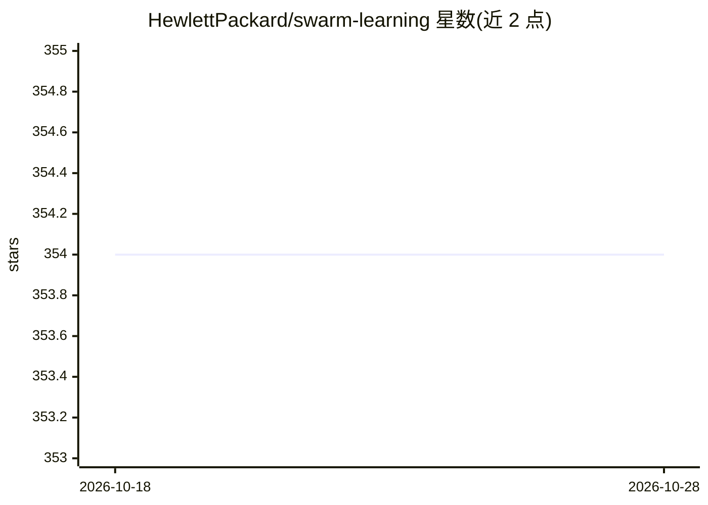

# HewlettPackard/swarm-learning

⭐ 354 · Python · Apache-2.0 · 推送 2026-10-13 · [GitHub](https://github.com/HewlettPackard/swarm-learning) · 组织维护

**面向分布式数据源的隐私保护去中心化机器学习框架**

HPE 开发的去中心化、隐私保护机器学习框架：在数据源附近（边缘）运行训练，仅通过区块链（开源 Ethereum）共享学习到的模型权重与元数据，不共享原始数据。由 SL/SN/SWCI/SWOP/SLM-UI 等容器化节点组成，用 X.509 证书保障通信安全，AutoPass License Server 管理许可证。用户可将 Keras/PyTorch/HuggingFace Trainer 的 Python3 训练程序加入 SwarmCallback API 改造为 Swarm 训练程序。限制：各 ML 节点须使用同一 ML 平台；需提供证书否则框架不初始化；本仓库分发包仅限非商业与实验用途。

## 筛选速览

| 维度 | 判定 | 备注 |
|---|---|---|
| AI 角色 | `ai-ecosystem` | LLM/agent 周边工具 |
| 许可风险 | `permissive` | Apache-2.0 |
| 部署形态 | `None` |  |
| 模型依赖 | — | README 未给出锁定关系 |
| 硬件要求 | — | 无带数字的原话,不猜 |
| 安装摩擦 | `low` | 无编译、无系统依赖或容器化 |
| 成熟度 | — | 结构信号不足 |

## 能力要点

- 训练在数据源处执行，仅共享模型权重而非原始数据
- 区块链（Ethereum）记录元数据以协调节点训练进度
- SwarmCallback API 改造 Keras/PyTorch/HuggingFace Trainer 程序
- 容器化节点架构与 SLM-UI 图形化安装、部署与监控

## 适用场景

- 多个机构在不交换原始数据的前提下协同训练模型
- 将现有 Keras/PyTorch 训练代码改造为分布式 Swarm 训练
- 监控与追踪去中心化训练的进度与历史

## 场景标签

`模型训练` · 领域:训练与推理

## 证据(README 行号)

> L4: Swarm Learning is a decentralized, privacy-preserving Machine Learning framework. This framework utilizes the comput
> L38: User can transform/modify any Keras or PyTorch or HuggingFace Trainer class based ML program that is written using 

## 星数曲线

2026-10-18 354 → 2026-10-28 354（+0）

---
*卡片 v1 · prompt 1.4 · 生成 2026-10-21 · 置信度 high · 依据 README sha `8491e5c267ec` · [字段定义](../../DATASET.md)*
